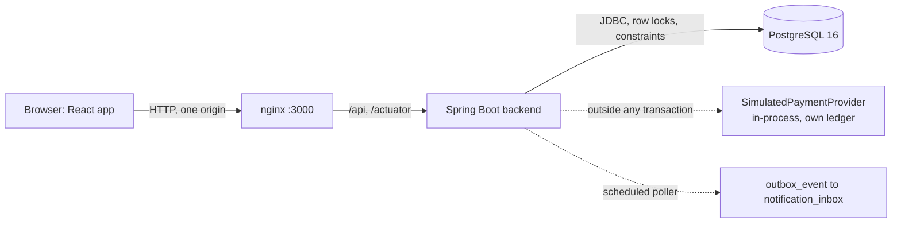

# Cinéva: Movie Ticket Booking System

Cinéva is a full-stack movie ticket booking system in the style of BookMyShow or Fandango, built
as the take-home assessment for the Copart SDET Internship. Customers find showtimes across
theaters and cities, pick exact seats, hold them for 8 minutes, pay through a simulated provider
and receive a ticket. Theater admins manage screens and showtimes for their own theaters.

The engineering focus is **correctness under concurrency, proven by automated tests**:

- A seat is never sold twice, even when many customers race for it.
- An expired hold is never converted into a booking, even if its seats are still free.
- A payment is never charged twice for one idempotency key, and an unknown outcome is never
  treated as a decline.

**Stack:** Java 21 and Spring Boot 3.5, PostgreSQL 16 with Flyway, React 19 with TypeScript and
Vite, Docker Compose. **Tests:** JUnit 5, Testcontainers (real PostgreSQL), Node's test runner and
Playwright.

This is a **human-directed, AI-assisted** project: the owner set scope, made the design
decisions, reviewed and merged every change, and AI coding agents drafted most of the code,
tests and documentation under that direction. See [How this project was built](#how-this-project-was-built).

## Contents

- [Screenshots](#screenshots)
- [Quick start](#quick-start)
- [Demo accounts (fictional, local only)](#demo-accounts-fictional-local-only)
- [Five-minute walkthrough](#five-minute-walkthrough)
- [What is implemented](#what-is-implemented)
- [Architecture at a glance](#architecture-at-a-glance)
- [Testing](#testing)
- [How this project was built](#how-this-project-was-built)
- [Deferred scope and known limitations](#deferred-scope-and-known-limitations)
- [Repository structure](#repository-structure)
- [Documentation](#documentation)
- [Troubleshooting](#troubleshooting)

## Screenshots

| Discover | Seats |
|---|---|
|  |  |
| **Checkout** | **Ticket** |
|  |  |

Captured from the local Compose stack with Playwright on 2026-11-02. My Tickets, the inbox and
the admin dashboard were added later and are not pictured.

## Quick start

**Prerequisites:** Docker with the Compose v2 plugin. Nothing else is needed to run the app.
Running the tests on the host also needs JDK 21+ and Node 22.18+ (see [Testing](#testing)).
The first build downloads base images and Maven and npm dependencies; after that, no hosted
service is used.

```bash
cp .env.example .env && docker compose up --build -d --wait
```

Then open <http://localhost:3000>.

- **`.env`** is git-ignored and holds the local PostgreSQL password. The placeholder value works
  locally.
- **`--wait`** returns once all three services are healthy. Compose starts `postgres`, then
  `backend` once the database is healthy, then `frontend` (nginx) once the backend's
  `/actuator/health` is `UP`.
- **One origin:** nginx serves the React app and proxies `/api` and `/actuator` to the backend,
  so no CORS is configured and the backend port is not published.

```bash
curl http://localhost:3000/actuator/health          # {"status":"UP"}
docker compose ps                                   # all three services "(healthy)"
docker compose down                                 # stop, keeping the database
```

To start again from an empty database, run `docker compose down -v` and then the start command.
**`-v` deletes the PostgreSQL volume, including every booking you made**, so only use it when you
want a fresh demo.

## Demo accounts (fictional, local only)

> These accounts are **fictional, intentionally public and for local assessment use only**. They
> are seeded by Flyway `V8__demo_users.sql` and `V11__e2e_test_users.sql` with BCrypt hashes. They
> are not real credentials and must never be used in a real deployment.

| Username | Password | Role | Assigned theater |
|---|---|---|---|
| `alice` | `alice-demo-pass` | Customer | — |
| `bob` | `bob-demo-pass` | Customer | — |
| `e2e.alice` | `e2e-alice-demo-pass` | Customer (used by Playwright) | — |
| `e2e.bob` | `e2e-bob-demo-pass` | Customer (used by Playwright) | — |
| `admin.dallas` | `dallas-admin-demo` | Theater admin | Starlight Cinemas Downtown |
| `admin.houston` | `houston-admin-demo` | Theater admin | Bayou Picture House |

- **Authentication** is stateless HTTP Basic: no signup, session, cookie or token. Basic sends
  credentials with every request, so any real deployment would need HTTPS. The local stack is
  plain HTTP, bound to `127.0.0.1`.
- **The React app** keeps credentials in memory only, never in `localStorage`, `sessionStorage`,
  cookies or IndexedDB. Reloading the page signs you out.

```bash
curl -u alice:alice-demo-pass http://localhost:3000/api/auth/me
curl 'http://localhost:3000/api/showtimes?cityId=2&date=2026-12-01&q=Intersteller'   # typo-tolerant search
```

Sample showtimes run from 2026-11-03 to 2027-01-31, at 13:00 and 16:30 America/Chicago, on every
screen ([`docs/sample-data.md`](docs/sample-data.md)).

## Five-minute walkthrough

1. **Discover (anonymous).** Open <http://localhost:3000>, choose Houston, and type the
   misspelled "Intersteller". The trigram search still finds *Interstellar*, which plays in
   Houston on most days; if the selected day has none, pick another day in the date strip.
2. **Seats.** Open a showtime and select two seats. The map shows standard and premium prices and
   refreshes every 15 s.
3. **Hold.** Click "Hold 2 seats" and sign in as `alice`. All the seats are held or none are,
   and checkout shows the 8-minute countdown.
4. **Decline, then pay.** Choose **Card declined** and pay: no booking, and the seats stay held.
   Choose **Card approved** and pay again: the new attempt uses a new idempotency key and
   returns a ticket with a booking reference. (**Provider timeout** shows "Confirming your
   payment…" and polls; it is never shown as declined.)
5. **My tickets and Inbox.** Both are in the header. The inbox entry comes from the outbox relay
   after the booking commits.
6. **Conflict.** In a private window, sign in as `bob` and open the same showtime: Alice's seats
   are unavailable. `GET /api/bookings/{id}` for Alice's booking returns 404 to Bob.
7. **Admin.** Sign in as `admin.dallas` at `/admin`, schedule a showtime for Starlight, and find
   it on Discover. An overlapping showtime on the same screen is rejected. `admin.houston` never
   sees Starlight (403 through the API). A showtime with bookings cannot be cancelled (409).

Reviewers who want the reasoning behind these behaviors can start with
[`docs/architecture.md`](docs/architecture.md) §5 (locking) and §6 (payment states).

## What is implemented

**Customer web app** (`frontend/`)
- Discover by city, a 7-day date strip, typo-tolerant search, genre and language.
- A movie's showtimes and a live seat map (15 s refresh).
- Sign-in when holding seats; checkout with a countdown and a simulated outcome (card approved,
  card declined, provider timeout), retry after a decline, and polling while an outcome is
  `UNKNOWN`.
- A digital ticket, My Tickets (confirmed bookings, newest first, 10 at a time) and an Inbox of
  booking notifications.
- After a reload, checkout can recover an active hold once you sign in again.

**Theater admin** (`/admin`, "Admin" in the header for admin accounts)
- Assigned theaters only: screens and seating plans, a day's schedule with booked and held
  counts, scheduling a showtime, adding a screen, and replacing a layout before the screen's
  first showtime.
- Cancelling a showtime that has no bookings, unresolved payments or live holds. Cancelled shows
  leave public search; nothing is deleted and nothing is refunded.

**Backend** (`backend/`): a modular monolith with packages `catalog`, `theater`, `booking`,
`payment`, `admin` and `security`, and 22 REST endpoints ([`docs/api.md`](docs/api.md)).
- **Seat holds:** all-or-nothing, ordered `SELECT … FOR UPDATE` locks with a 2 s lock timeout,
  one active hold per customer per showtime, lazy expiry against an injected UTC `Clock` (no
  background job).
- **Payments:** idempotency keys, at most 3 attempts per hold, `UNKNOWN` outcomes resolved on
  demand with a ledger fence, a late capture after hold expiry voided, and a guard that refuses
  to call the provider inside a database transaction.
- **Database backstops:** constraints such as `UNIQUE (showtime_id, seat_id)` on booked seats,
  a partial unique index for active holds, and an exclusion constraint against overlapping
  showtimes. All schema changes are Flyway migrations V1–V13.
- **Authorization:** customers only ever see their own holds, payments, bookings and
  notifications (404 for others'); admins are scoped to assigned theaters in the service layer
  (403 otherwise).
- **Outbox relay:** the booking transaction writes a `BookingConfirmed` event; an in-process
  poller delivers it at least once into `notification_inbox`, idempotent by event id, with
  `claim_token` fencing against stale workers. This is not email and not Kafka.

The requirement-by-requirement status, with the tests that prove each item, is in
[`docs/requirements-checklist.md`](docs/requirements-checklist.md).

## Architecture at a glance



- **PostgreSQL is the only source of truth for seat ownership.** No cache holds seat state.
- **Three short transactions per purchase:** create the hold (TX1), start a payment attempt
  (TX2), and confirm the booking (TX3). The simulated charge happens between TX2 and TX3, never
  inside a transaction.
- **Redis, Kafka and Solr are deferred** by accepted ADRs ([`docs/decisions/`](docs/decisions/)).
  PostgreSQL row locks, a transactional outbox and `pg_trgm` cover what they would have done at
  this scale.
- **Scale:** the 2,000-theater, 300-city, 500,000-visitors-in-10-minutes target is discussed in
  [`docs/architecture.md`](docs/architecture.md) §12. It has **not** been load-tested, and no
  throughput claim is made.

## Testing

| Suite | Tests | What it proves | Command |
|---|---|---|---|
| Backend unit (JUnit 5) | 66 | Hold and payment state rules, paging, scheduling and DST, access policy, security filter chain | `cd backend && ./mvnw -B clean verify` |
| Backend integration (Spring Boot + Testcontainers PostgreSQL 16) | 186 | Constraints, holds, payments, concurrency, discovery, admin, authorization, outbox delivery | (same command) |
| Frontend unit (Node test runner) | 53 | API client retries and keys, payment-outcome handling, seat selection, ticket paging, admin forms | `cd frontend && npm ci && npm test` |
| End-to-end (Playwright, Chromium) | 10 | Booking, decline then retry, seat conflict, search race, My Tickets, admin scheduling and cancellation | `cd frontend && npm run test:e2e` (stack running) |

Latest results: **all 315 tests passed with 0 skipped** on 2026-11-03 (Task 14 final audit,
macOS, JDK 23 targeting Java 21, Node 25.9). Details and earlier runs are in
[`docs/test-strategy.md`](docs/test-strategy.md).

How the tests stay meaningful and deterministic:
- **Real PostgreSQL**, never H2, so locks, partial indexes, exclusion constraints and
  `lock_timeout` behave as they do in production.
- **Concurrency tests** release threads together with a `CountDownLatch` and assert database
  state: exactly one holder per seat, one charge per key, one showtime per overlapping slot.
- **Time is controlled** with a mutable test `Clock`; no test sleeps to expire a hold.
- **Payment scenarios** cover success, decline, timeout, idempotent replay (charge count stays
  1), unknown outcomes and late capture after expiry.
- **Mutation checks** during development broke the code on purpose to confirm that key tests
  fail ([`docs/ai-workflow.md`](docs/ai-workflow.md) §5).

**All suites, one command.** With the stack running, from the repository root:

```bash
./run-tests.sh
```

It runs the backend unit and integration tests, the frontend unit tests and Playwright in that
order, stops at the first failure, and also fails if the stack is unhealthy or any suite reports
a skipped test. It needs bash, curl, JDK 21+, Node 22.18+ and Docker, and has been run on Linux
and macOS; on Windows, use WSL. The first E2E run on a machine needs Chromium once:
`cd frontend && npx playwright install --with-deps chromium` (uses sudo on Linux).

E2E notes: the suite targets `http://localhost:3000` (override with `E2E_BASE_URL`). Each test
schedules its own showtime through the admin API and books as `e2e.alice` / `e2e.bob`, so runs
are independent, need no database reset and leave Alice's and Bob's history alone. Retries are
disabled; reports go to `frontend/playwright-report/` and failure traces to
`frontend/test-results/`.

## How this project was built

Cinéva was built by one engineer, the repository owner, directing Cursor AI coding agents.
Neither side did everything: the record below is kept in
[`docs/ai-workflow.md`](docs/ai-workflow.md), with dated entries for human review findings, AI
mistakes and how each was caught.

| Responsibility | Owner (human) | AI coding agents |
|---|---|---|
| Scope and priorities | Defined each task, its acceptance criteria and what was cut | Proposed plans and flagged scope risks |
| Architecture and design | Made the key decisions: expired holds never convert, `UNKNOWN` is never a decline, injectable UTC `Clock`, HTTP Basic with in-memory credentials, ordered locks, no speculative interfaces, Redis/Kafka/Solr deferred | Drafted the design documents and ADRs for review |
| Code and tests | Reviewed pull requests and requested changes ([`docs/ai-workflow.md`](docs/ai-workflow.md) §4) | Wrote most of the application code, migrations and tests from the task prompts |
| Verification | Reviewed reported results, used the running app by hand, and required evidence such as failing-first regressions and a runner that fails on skipped tests | Ran the suites and recorded the exact commands and results, labeling anything not run |
| Review and merge | Reviewed and merged all 12 pull requests; only the owner merges to `main` | Worked only on feature branches; never merged, rebased, squashed or force-pushed |
| Documentation | Set the honesty rules and accepted the docs | Drafted the docs from the code and test results |

Defects caught in the owner's review include an E2E fixture that silently sent the wrong query
parameter (Task 08), a payment reconciliation race (PR #4), and two outbox reliability defects:
a unique-violation caught inside a transaction, and missing claim fencing (Task 13). Each led to
a fix with a regression test. The working rules for agents are in [`AGENTS.md`](AGENTS.md).

## Deferred scope and known limitations

What was deliberately left out, why, and what was built instead is listed in
**[`docs/deferred-scope.md`](docs/deferred-scope.md)**. In short: Redis, Kafka and Solr; real
payments and refunds; customer cancellation; real identity management and HTTPS; background
sweepers and reconciliation; production scale infrastructure; and load testing.

Known limitations of what *is* built:
- **Not production-ready:** one instance, plain HTTP, simulated payments, no load testing.
- **Payments:** the simulated provider's ledger has properties real providers do not guarantee
  (architecture §6.7). An `UNKNOWN` payment that nobody polls stays unresolved; its hold still
  expires normally.
- **Cancellation:** refused while a payment is `PENDING` or `UNKNOWN`; if that attempt then
  captures, the show has a booking and cannot be cancelled.
- **Outbox:** at-least-once inside this process. After 8 failed claims an event stays unpublished
  with `last_error` for inspection. No exactly-once or email delivery is claimed.
- **Reload:** credentials and checkout state live only in memory, so a reload signs you out.
- **Search typed just before leaving Discover:** text not yet committed to the URL (under
  300 ms) is not kept in the history entry, so Back shows Discover without it.
- **UI defects found in the final audit:** fixed in Task 15, each with a regression test (admin
  columns overlapping between about 1024 and 1424 px, one-click "Cancel showtime", and
  "1 showtimes" on Discover); see
  [`docs/requirements-checklist.md`](docs/requirements-checklist.md) §10–11.
- **Sample data window:** seeded showtimes end on 2027-01-31; after that, Discover shows no
  seeded showtimes and the Playwright fixture's screen lookup fails.
- **Ports:** host ports `3000` and `5432` must be free, or set `FRONTEND_HOST_PORT` and
  `POSTGRES_HOST_PORT` in `.env`.

## Repository structure

```
backend/                 Spring Boot application (Maven wrapper, Dockerfile)
  src/main/java/com/moviebooking/
    catalog/ theater/ booking/ payment/ admin/ security/ config/
  src/main/resources/db/migration/   Flyway V1–V13 (schema, sample data, demo and Playwright users, outbox)
  src/test/java/         JUnit unit tests (*Test) and Testcontainers integration tests (*IT)
frontend/                React + TypeScript + Vite app, nginx config, Dockerfile
  src/                   pages, components, features, API client, unit tests (*.test.ts)
  e2e/                   Playwright tests and fixtures
docs/                    scope, deferred scope, architecture, data model, API, tests, ADRs, AI workflow
docker-compose.yml       postgres + backend + frontend
run-tests.sh             runs every test suite against the running stack
.env.example             placeholder local settings (copy to .env)
AGENTS.md                assignment constraints and working rules for contributors and AI agents
```

## Documentation

| Document | Contents |
|---|---|
| [`docs/requirements-checklist.md`](docs/requirements-checklist.md) | Every requirement and acceptance criterion mapped to code and tests |
| [`docs/deferred-scope.md`](docs/deferred-scope.md) | Omitted features, why, and what was built instead |
| [`docs/product-scope.md`](docs/product-scope.md) | Roles, workflows, acceptance criteria, failure cases |
| [`docs/architecture.md`](docs/architecture.md) | Modular monolith, locking, payment states, time, auth, outbox, scale notes |
| [`docs/data-model.md`](docs/data-model.md) | ERD and constraints from Flyway V1–V13 |
| [`docs/api.md`](docs/api.md) | REST reference with real request and response examples |
| [`docs/test-strategy.md`](docs/test-strategy.md) | What each suite proves, and the recorded results of every task |
| [`docs/decisions/`](docs/decisions/) | ADRs 0001–0003: Redis, Kafka and Solr deferred (accepted) |
| [`docs/ai-workflow.md`](docs/ai-workflow.md) | How AI assistance was directed and reviewed, with findings and mistakes |
| [`docs/implementation-plan.md`](docs/implementation-plan.md) | The original 10-hour phased plan (historical) |
| [`docs/sample-data.md`](docs/sample-data.md) | Seeded cities, theaters, showtimes and users |

## Troubleshooting

**Containers cannot reach each other.** If the stack starts but every API call through
`http://localhost:3000` hangs or returns a gateway error, the host firewall may be dropping
traffic between containers. In the Cursor cloud agent VM used for part of this project, a stale
`iptables-legacy` `FORWARD` policy of `DROP` did exactly that and needed a one-time
`sudo iptables-legacy -P FORWARD ACCEPT`. Standard Docker Desktop and Docker Engine installs do
not need this.
