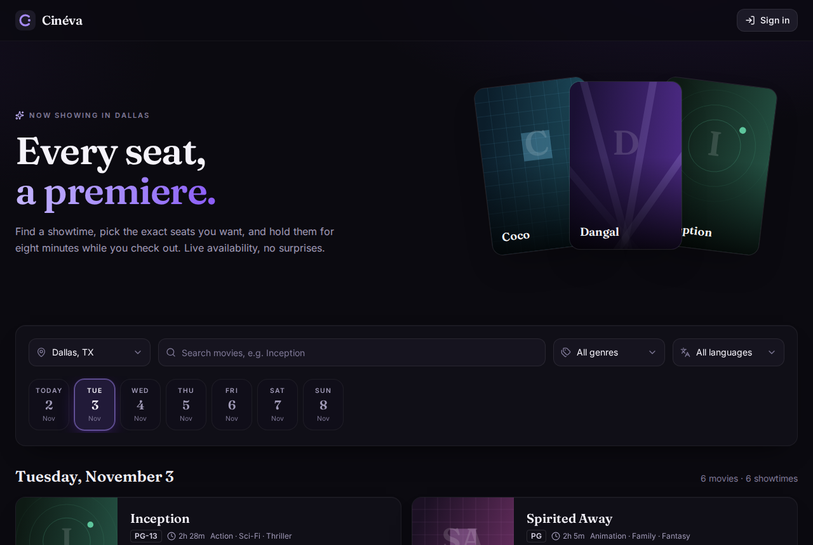
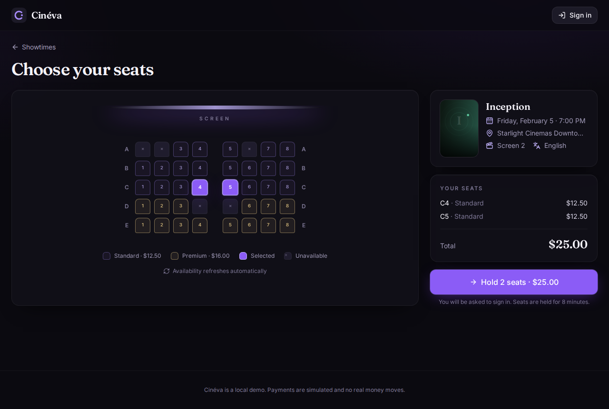
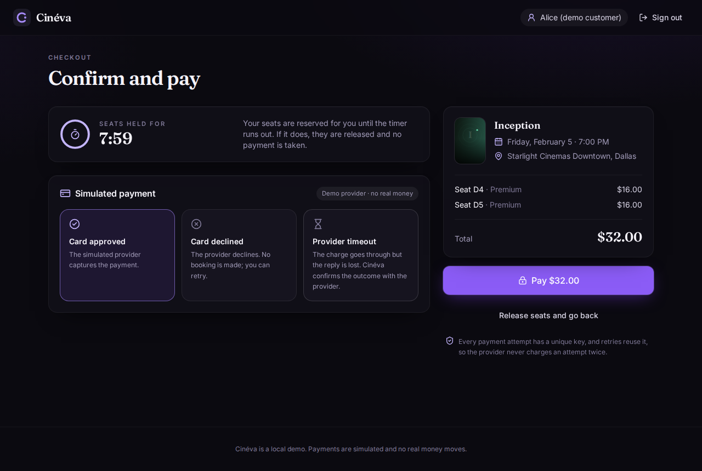
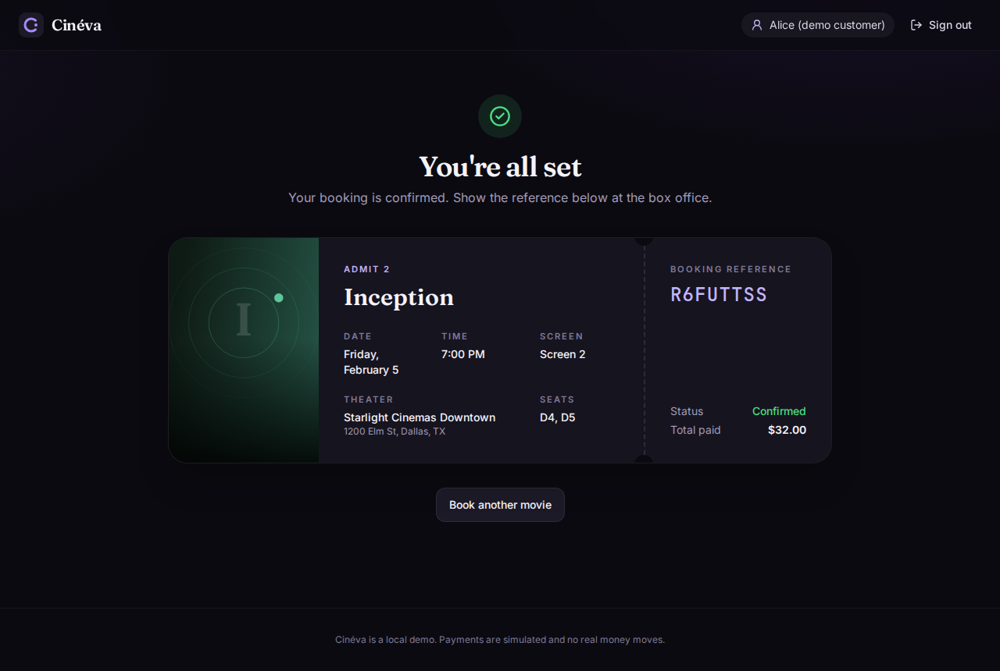

# Movie Ticket Booking System

A movie ticket booking system (in the style of BookMyShow or Fandango), built as the Copart SDET
Internship take-home assessment. Customers find showtimes across theaters and cities, pick exact
seats, hold them for 8 minutes, pay through a simulated provider, and get a confirmed ticket.
Theater admins schedule showtimes for their own theaters from `/admin`.

The focus is **correctness under concurrency** (a seat is never sold twice, and an expired hold is
never booked) and **automated proof** of it. The stack is Spring Boot 3.5 (Java 21), PostgreSQL 16,
React 19 and Docker Compose.

| | |
|---|---|
| Requirements coverage | [`docs/requirements-checklist.md`](docs/requirements-checklist.md) |
| Product scope and deferred features | [`docs/product-scope.md`](docs/product-scope.md) |
| Architecture, booking and payment flow | [`docs/architecture.md`](docs/architecture.md) |
| Data model (ERD from Flyway V1–V10) | [`docs/data-model.md`](docs/data-model.md) |
| REST API reference | [`docs/api.md`](docs/api.md) |
| Test strategy and final results | [`docs/test-strategy.md`](docs/test-strategy.md) |
| Decisions: Redis, Kafka, Solr deferred (accepted) | [`docs/decisions/`](docs/decisions/) |
| AI-assisted workflow record | [`docs/ai-workflow.md`](docs/ai-workflow.md) |
| Sample data | [`docs/sample-data.md`](docs/sample-data.md) |

## Screenshots

| Discover | Seats |
|---|---|
|  |  |
| **Checkout** | **Ticket** |
|  |  |

The screenshots were captured from the local Compose stack with Playwright on 2026-11-02.

## Quick start

**Prerequisites:** Docker with the Compose v2 plugin. Nothing else is needed to run the app.
Running the E2E tests on the host also needs Node 22.18 or later. Building the images downloads
base images, Maven and npm dependencies once; after that, no hosted service is used.

```bash
cp .env.example .env && docker compose up --build -d --wait
```

Then open <http://localhost:3000>.

- **`.env`:** git-ignored, and holds the local PostgreSQL password. The placeholder value works
  locally; change it if you like.
- **`--wait`:** returns once all three services report healthy. Compose starts `postgres`, then
  `backend` once the database is healthy, then `frontend` (nginx) once the backend's
  `/actuator/health` is `UP`.
- **Proxy:** nginx serves the React app and proxies `/api` and `/actuator` to the backend, so the
  browser talks to one origin and no CORS is configured. The backend port is not published.

To check the stack:

```bash
curl http://localhost:3000/actuator/health          # {"status":"UP"}
docker compose ps                                   # all three services "(healthy)"
```

To start again from an empty database, and to stop:

```bash
docker compose down -v && docker compose up --build -d --wait   # clean start
docker compose down                                             # stop (keeps data)
```

## Demo accounts (fictional, local only)

> These accounts are **fictional, intentionally public and for local assessment use only**. They are
> seeded by Flyway `V8__demo_users.sql` and `V11__e2e_test_users.sql` (BCrypt hashes) and must
> never be used in a real deployment. They are not real credentials.

| Username | Password | Role | Assigned theater |
|---|---|---|---|
| `alice` | `alice-demo-pass` | Customer | — |
| `bob` | `bob-demo-pass` | Customer | — |
| `e2e.alice` | `e2e-alice-demo-pass` | Customer (Playwright only) | — |
| `e2e.bob` | `e2e-bob-demo-pass` | Customer (Playwright only) | — |
| `admin.dallas` | `dallas-admin-demo` | Theater admin | Starlight Cinemas Downtown |
| `admin.houston` | `houston-admin-demo` | Theater admin | Bayou Picture House |

- **Authentication:** stateless HTTP Basic; there is no signup, session, cookie or token. Basic
  sends credentials with every request, so any real deployment would need HTTPS. The local
  stack is plain HTTP, bound to `127.0.0.1`.
- **The React app:** keeps credentials in memory only, never in `localStorage`,
  `sessionStorage`, cookies or IndexedDB. Reloading the page signs you out.

```bash
curl -u alice:alice-demo-pass http://localhost:3000/api/auth/me
curl 'http://localhost:3000/api/showtimes?cityId=2&date=2026-11-03&q=Intersteller'   # typo-tolerant search
```

The sample showtimes run from 2026-11-03 to 2027-01-31, at 13:00 and 16:30 in America/Chicago,
on every screen ([`docs/sample-data.md`](docs/sample-data.md)). Theater admins use `/admin`,
or `POST /api/admin/showtimes` ([`docs/api.md`](docs/api.md)).

## What is implemented

**Customer web app (React, `frontend/`):**
- Discover: city, a 7-day date strip, typo-tolerant search, and genre and language filters.
- A movie's showtimes, and a live seat map that refreshes every 15 s.
- Sign-in when holding seats.
- Checkout with a countdown and a simulated outcome (`SUCCESS`, `DECLINE`, `TIMEOUT`), with retry
  after a decline and polling while an outcome is `UNKNOWN`.
- A digital ticket.
- My Tickets (`/tickets`, "My tickets" in the header): the signed-in customer's confirmed
  bookings, newest first, each opening its ticket. Like the sign-in, the list is kept in memory
  only, so a reload or sign-out asks you to sign in again.
- Admin (`/admin`, "Admin" in the header for theater-admin accounts): assigned theaters only,
  screens and seating plans, a day's showtimes, a form to schedule a showtime, and cancellation
  of a show that has no bookings, unresolved payments or live holds. Customer-only actions such
  as holding seats are hidden.

**Backend (Spring Boot, `backend/`):** a modular monolith with packages `catalog`, `theater`,
`booking`, `payment`, `admin` and `security`.
- **Seat holds:** all-or-nothing, with ordered row locks and a 2 s lock timeout. Holds expire
  lazily by an injected UTC `Clock`, with no background job.
- **Payments:** idempotency keys, unknown outcomes resolved on demand, and a late capture after
  hold expiry is voided.
- **Database backstops:** constraints such as `UNIQUE (showtime_id, seat_id)` on booked seats.
- **Admin:** theater-scoped showtime creation, with overlaps rejected by an exclusion
  constraint; assigned-theater reads; adding a screen; replacing a layout only before the
  screen's first showtime; cancelling a showtime that has no bookings, unresolved payments or
  live holds (no fake refunds, no row deletion).
- **Booking history:** `GET /api/bookings` lists only the caller's confirmed bookings, paginated
  (size capped at 50). The customer comes from the credentials, never from a parameter.
- **Hold lookup:** `GET /api/holds/{id}` returns the owner's current hold state from the injected
  Clock without extending expiry. Other customers get 404.
- **Outbox relay:** a local Spring poller delivers `BookingConfirmed` events into
  `notification_inbox` (at-least-once, idempotent by event id). `GET /api/notifications` and
  `/notifications` show the caller's inbox. This is not email and not Kafka.

**Not implemented (by design or cut for time):**
- Customer booking cancellation and refunds.
- Hold-cleanup sweeper and scheduled payment reconciliation.
- Redis, Kafka and Solr, which are deferred by the ADRs.

**Honest limitations of this task:**
- Reloading the React app still signs you out. Credentials are never written to
  `localStorage` / `sessionStorage` / cookies / IndexedDB. After a reload, checkout can look the
  hold up again only once you sign in.
- Cancellation refuses while a simulated payment is `PENDING` or `UNKNOWN`. If that attempt then
  captures, the show has bookings and cannot be cancelled; Cinéva does not void or refund it.
- Outbox delivery is at-least-once inside this process. A crash between inbox insert and
  `published_at` is retried; `ON CONFLICT (event_id) DO NOTHING` prevents a duplicate row. A
  worker whose 30 s claim lease expired cannot ack or fail a row another worker has reclaimed
  (`claim_token`). There is no claim of exactly-once network or email delivery. After eight
  failed claims an event stays unpublished with `last_error` for inspection.

The full status is in [`docs/requirements-checklist.md`](docs/requirements-checklist.md).

## Running the tests

**All suites, one command.** With the stack running (`docker compose up --build -d --wait`), from
the repository root:

```bash
./run-tests.sh
```

It runs the backend unit and integration tests, the frontend unit tests and the Playwright E2E
tests against the running stack, in that order. It stops at the first failure with a non-zero exit
code. It also fails if the stack is not healthy, or if any suite reports a skipped test.
It needs bash, curl, JDK 21 or newer, Node 22.18+ and Docker. It has been run on Linux and
macOS (with JDK 23).
On Windows, use WSL. The first E2E run on a new machine needs the browser's system libraries once:
`cd frontend && npx playwright install --with-deps chromium` (uses sudo on Linux).

Each suite can also be run on its own:

| Suite | Command | Needs |
|---|---|---|
| Backend unit and integration (Testcontainers PostgreSQL 16) | `cd backend && ./mvnw -B clean verify` | JDK 21, Docker |
| Frontend unit tests | `cd frontend && npm ci && npm test` | Node 22.18+ |
| Frontend type-check and production build | `cd frontend && npm run build` | Node 22.18+ |
| End-to-end (Playwright, Chromium) | see below | Node 22.18+, the Compose stack running |

**End-to-end tests:** with the stack running, from the repository root:

```bash
cd frontend && npm ci && npx playwright install --with-deps chromium && npm run test:e2e
```

- After the first setup, `npm run test:e2e` alone runs the suite.
- The suite targets `http://localhost:3000`; set `E2E_BASE_URL` to change it.
- Each test schedules its own showtime through the admin API, so runs are independent and need no
  database reset. Those showtimes stay in the database until `docker compose down -v`.
- Retries are disabled. Reports go to `frontend/playwright-report/`, and traces of failed tests to
  `frontend/test-results/`.

What each suite proves, and the latest results, are in
[`docs/test-strategy.md`](docs/test-strategy.md). The latest results were 66 backend unit tests,
186 integration tests, 53 frontend unit tests and 9 Playwright tests, all passing, on
2026-11-03.

## Repository structure

```
backend/                 Spring Boot application (Maven wrapper, Dockerfile)
  src/main/java/com/moviebooking/
    catalog/ theater/ booking/ payment/ admin/ security/ config/
  src/main/resources/db/migration/   Flyway V1–V13 (schema, sample data, demo and Playwright users, outbox relay)
  src/test/java/         JUnit unit tests (*Test) and Testcontainers integration tests (*IT)
frontend/                React + TypeScript + Vite app, nginx config, Dockerfile
  src/                   pages, components, features, API client, unit tests (*.test.ts)
  e2e/                   Playwright tests and fixtures
docs/                    product scope, architecture, data model, API, tests, ADRs, AI workflow
docker-compose.yml       postgres + backend + frontend
.env.example             placeholder local settings (copy to .env)
AGENTS.md                assignment constraints and working rules
```

## Known limitations

- **Not production-ready, no scale claims:** one instance, plain HTTP, simulated payments, and no
  load testing. The design notes for the 500,000-visitor target are in architecture §12.
- **Payments:** the simulated provider has properties that real providers do not guarantee
  (architecture §6.7). An `UNKNOWN` payment that nobody polls stays unresolved until a poll; its
  hold still expires normally.
- **Sample data window:** the seeded showtimes end on 2027-01-31. After that, discovery shows no
  seeded showtimes, and the Playwright fixture, which finds a screen through the next 14 days of
  seeded showtimes, fails.
- **Search typed just before leaving Discover:** the search box updates the URL after a 300 ms
  delay. Opening a showtime within that window now keeps you on the showtime (fixed in Task 10,
  covered by `search-navigation.spec.ts`), but the unsaved search text is not kept, so Back
  shows Discover without it.
- **My Tickets:** confirmed bookings only (there is no cancellation). It loads 10 at a time,
  and "Show older tickets" loads the next 10; there is no search or filter.
- **Reload during checkout:** credentials and checkout state live only in memory, so a reload
  signs you out. After you sign in again, checkout can recover an ACTIVE hold via
  `GET /api/holds/{id}`. Passwords are never stored to skip that sign-in.
- **Port conflicts:** host ports `3000` (frontend) and `5432` (PostgreSQL) must be free, or set
  `FRONTEND_HOST_PORT` and `POSTGRES_HOST_PORT` in `.env`.

### Troubleshooting: containers cannot reach each other

If the stack starts but every API call through `http://localhost:3000` hangs or ends in a gateway error, the
host firewall may be dropping traffic between containers. In the Cursor cloud agent VM used to
build this project, a stale `iptables-legacy` `FORWARD` policy of `DROP` did exactly that. It
needed a one-time `sudo iptables-legacy -P FORWARD ACCEPT`. This is a property of that VM, not of
the project, and standard Docker Desktop or Docker Engine installs do not need it.
