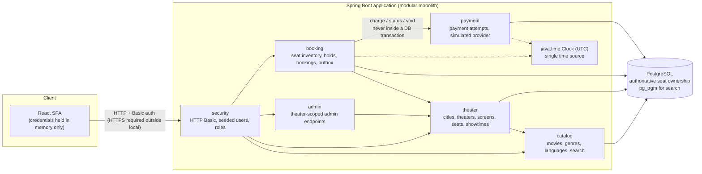
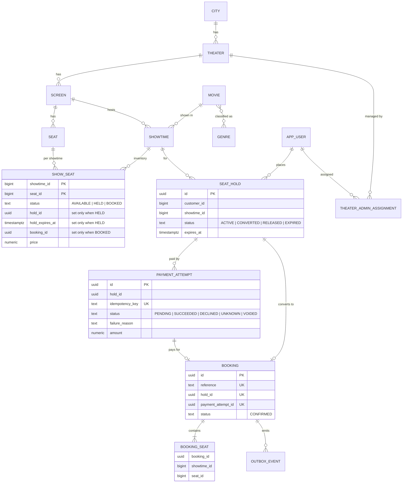
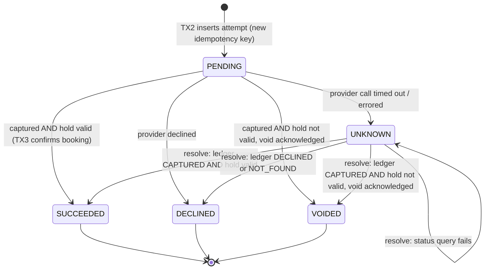
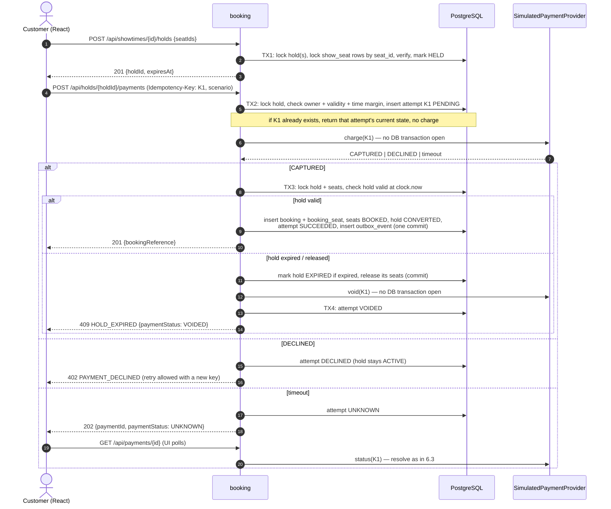

# Architecture

> **Status: PROPOSED DESIGN. No application code exists yet.**
> This document describes the intended design. Section 13 tracks what is actually implemented;
> at the time of writing, **nothing is implemented**. Any statement below such as "the system
> does X" describes the target design, not verified behavior.
>
> Revision 2 applies design decisions approved by the engineering owner during review of PR #1
> (see `docs/ai-workflow.md` §4). Those are decisions about the *design*; no code has been
> written or verified.

## 1. Approach: modular monolith

One Spring Boot application, one PostgreSQL database, and one React single-page app, all
running locally via Docker Compose.

Why a modular monolith rather than microservices:

- **Correctness is easiest in one database.** The core invariant (a seat is sold at most once)
  is enforced by PostgreSQL transactions, row locks, and constraints. Splitting inventory,
  booking, and payment into services would need distributed coordination for no benefit at
  this scope.
- **The 10-hour budget.** One build, one deployment, one test harness.
- **Code that can be changed live during review.** Each module is a plain Java package with a
  straightforward `controller → service → repository` structure. There are **no speculative
  interfaces, ports/adapters, or extra layers**: an interface is introduced only when there are
  two real implementations.
- **Stateless app tier.** Requests carry HTTP Basic credentials and there is no server session,
  so the app could be scaled horizontally. The database remains the scaling constraint (§11).

## 2. Component diagram



## 3. Packages and ownership

| Package | Owns | Tables (proposed) |
|---|---|---|
| `catalog` | Movies, languages, genres; showtime search query | `movie`, `genre`, `movie_genre` |
| `theater` | Cities, theaters, screens, physical seats, showtimes; creating `show_seat` rows when a showtime is created | `city`, `theater`, `screen`, `seat`, `showtime` |
| `booking` | Per-showtime seat inventory, holds, bookings, outbox events | `show_seat`, `seat_hold`, `booking`, `booking_seat`, `outbox_event` |
| `payment` | Payment attempts, simulated provider and its ledger | `payment_attempt`, `simulated_provider_charge` |
| `admin` | Theater-admin REST endpoints; delegates to `theater` services | — |
| `security` (shared) | Spring Security config, seeded users, theater-admin assignments | `app_user`, `theater_admin_assignment` |

Rules:

- A package writes only its own tables. Other packages call its **concrete service classes**;
  they do not use its repositories directly.
- The showtime **search** is a single read-only SQL query in `catalog` that joins theater and
  city data. This is the one documented cross-package read.
- The booking confirmation transaction updates `payment_attempt` by calling the `payment`
  service within the same transaction (Spring `REQUIRED` propagation). This is a deliberate
  cross-package write inside one atomic unit (§6.4).
- Package boundaries are enforced by convention and review. No ArchUnit or Spring Modulith
  test is planned for the MVP.

## 4. Data model (proposed)

### 4.1 Entity-relationship diagram



### 4.2 Held seats versus booked seats

| | **Held** | **Booked** |
|---|---|---|
| Meaning | Temporarily reserved for one customer's checkout | Permanently sold |
| Where recorded | `show_seat.status = 'HELD'` with `hold_id` and `hold_expires_at` | `show_seat.status = 'BOOKED'` with `booking_id`, **and** a `booking_seat` row |
| Lifetime | Until hold expiry (TTL), release, or conversion | Permanent (no cancellation in MVP) |
| Reversible | Yes: expiry or release makes the seat available again | No: no code path moves `BOOKED` to any other status |
| Protected by | Row locks + status checks | Row locks + status checks + **unique constraint** |

### 4.3 Constraints (explicit)

```
-- The "never sold twice" backstop: at most one booking per seat per showtime, ever.
booking_seat:     UNIQUE (showtime_id, seat_id)

-- One hold or one payment can produce at most one booking.
booking:          UNIQUE (hold_id), UNIQUE (payment_attempt_id), UNIQUE (reference)

-- An idempotency key maps to exactly one attempt (and therefore at most one charge).
payment_attempt:  UNIQUE (idempotency_key)
-- At most one in-flight attempt per hold.
payment_attempt:  UNIQUE (hold_id) WHERE status IN ('PENDING', 'UNKNOWN')

-- The simulated provider charges at most once per key (defense in depth).
simulated_provider_charge: UNIQUE (idempotency_key)

-- One ACTIVE hold per customer per showtime (see §5.5 for why this is valid).
seat_hold:        UNIQUE (customer_id, showtime_id) WHERE status = 'ACTIVE'

-- Row shape matches status.
show_seat CHECK:  (status = 'AVAILABLE' AND hold_id IS NULL AND hold_expires_at IS NULL AND booking_id IS NULL)
               OR (status = 'HELD'      AND hold_id IS NOT NULL AND hold_expires_at IS NOT NULL AND booking_id IS NULL)
               OR (status = 'BOOKED'    AND hold_id IS NULL AND hold_expires_at IS NULL AND booking_id IS NOT NULL)
```

`show_seat` rows are created for every physical seat when a showtime is created. This trades
storage for simple, lockable rows (one per sellable seat per show).

## 5. Seat holds and locking

### 5.1 Lock order (global rule)

Every transaction that locks both holds and seats acquires locks in this order:

1. `seat_hold` row(s) (`FOR UPDATE`)
2. `show_seat` rows for **one showtime**, ordered by `seat_id` ascending (`FOR UPDATE`)

All writers follow the same order, so overlapping requests cannot deadlock. If a deadlock is
nevertheless detected by PostgreSQL, the transaction fails and the request returns a retryable
error. It is never silently retried with a partial result.

### 5.2 Bounded lock wait

Each locking transaction sets `SET LOCAL lock_timeout = '2s'` (proposed value, configurable).
If a lock cannot be acquired in time (SQLSTATE `55P03`), the transaction rolls back and the API
returns **409 `SEATS_BUSY`** (retryable). Nothing is partially held. Waits are expected to be
short because transactions contain no network calls and touch at most 10 seat rows.

### 5.3 Creating a hold (TX1)

Input: `showtimeId`, `seatIds`, authenticated customer, `now = clock.instant()`.

**Validation before any locking (400 `INVALID_REQUEST`):**
- `seatIds` is empty or has more than 10 entries.
- `seatIds` contains **duplicates**. These are rejected, not de-duplicated, so the client and
  server agree on exactly what was requested.

**Transaction:**
1. Load the showtime. It must exist (404) and be `SCHEDULED` with `starts_at > now` (409 `SHOWTIME_CLOSED`).
2. Lock this customer's `ACTIVE` hold(s) for the showtime (`seat_hold … FOR UPDATE`):
   - If one exists with `expires_at > now`, return 409 `ACTIVE_HOLD_EXISTS` (including its id).
     The customer must release it or let it expire.
   - If one exists with `expires_at <= now`, mark it `EXPIRED` and add its seats to the set to lock (step 3).
3. Lock the `show_seat` rows for (requested seats ∪ seats of the expired hold from step 2),
   `WHERE showtime_id = :showtimeId AND seat_id IN (…) ORDER BY seat_id FOR UPDATE`.
4. **Missing seats:** if any requested `seat_id` has no `show_seat` row for this showtime
   (unknown id, or a seat from a different screen), roll back and return 400 `INVALID_SEATS`
   listing the ids.
5. Reset any seats of the expired hold from step 2 to `AVAILABLE`.
6. A requested seat is **holdable** if `status = 'AVAILABLE'`, or if `status = 'HELD' AND
   hold_expires_at <= :now` (lazy expiry; the stale hold id on that row is overwritten).
7. If any requested seat is not holdable, roll back and return **409 `SEATS_UNAVAILABLE`**
   listing the conflicting ids. **No partial holds.**
8. Insert `seat_hold(status = ACTIVE, expires_at = now + TTL)` and set the requested rows to
   `HELD` with `hold_id` and `hold_expires_at`. Commit.

**Overlapping multi-seat requests.** Suppose customer A requests seats {1, 2, 3} and customer B
requests {3, 4} at the same time. Both lock in ascending order. Whichever locks seat 3 first
proceeds. The other waits for that lock, bounded by the lock timeout:
- If the winner commits, PostgreSQL (READ COMMITTED) re-reads the row after the wait, the loser
  sees `HELD`, rolls back, and gets 409 `SEATS_UNAVAILABLE: [3]`. None of its seats are held.
- If the winner rolls back, the loser proceeds normally.
- If the wait exceeds the lock timeout, the loser gets 409 `SEATS_BUSY`.

### 5.4 Expiry without background workers

- **Correctness never depends on a background job.** A hold is effectively expired when
  `expires_at <= now`. Every transaction that reads hold or seat state for a decision applies
  that rule (lazy expiry).
- **Seat-map reads** compute the effective status: a `HELD` row with `hold_expires_at <= :now`
  is shown as available.
- `seat_hold.status` may remain `ACTIVE` after expiry until a transaction touches it (§5.3
  step 2, §6.4, or a release). Code must use "effective" state, never the raw status alone.
- An optional cleanup sweeper is on the cut list (`docs/implementation-plan.md`). If built, it
  uses the same lock order and `SKIP LOCKED`.

### 5.5 One active hold per customer per showtime

**Rejected rule:** `UNIQUE (customer_id, showtime_id)` without a predicate. It would block every
future hold by that customer for that showtime, including after expiry or release. A
time-based partial index (`WHERE expires_at > now()`) is not possible either, because
PostgreSQL index predicates must be immutable.

**Adopted rule:** `UNIQUE (customer_id, showtime_id) WHERE status = 'ACTIVE'`. This is valid
because §5.3 step 2 transitions an expired `ACTIVE` hold to `EXPIRED` **in the same
transaction** before inserting the new one. Released and converted holds are already non-`ACTIVE`.
If two concurrent requests from the same customer both find no active hold, the index rejects
the second insert. That request returns 409 `ACTIVE_HOLD_EXISTS`.

### 5.6 Releasing a hold

`DELETE /api/holds/{id}`:
- Only by the hold's owner. Any other caller gets **404**, so hold ids of other customers are
  not revealed.
- Rejected with 409 `PAYMENT_IN_PROGRESS` if the hold has a `PENDING` or `UNKNOWN` payment attempt.
- Otherwise: lock the hold, then its seats (lock order). Set seats to `AVAILABLE` and the hold
  to `RELEASED`. Releasing an already expired or released hold is a no-op returning 204.

## 6. Payment

### 6.1 Simulated provider

- `SimulatedPaymentProvider` is one concrete class in `payment` (no interface; there is one
  implementation). Operations: `charge(key, amount, scenario)`, `status(key)`, `void(key)`.
- It represents an external system. It keeps its own ledger in `simulated_provider_charge`
  (`UNIQUE (idempotency_key)`), written in its **own** short transaction. A second `charge`
  with an existing key returns the recorded result without creating a new charge.
- Scenarios are chosen by the client (checkout scenario selector or test card number):

| Scenario | Ledger effect | Response to caller |
|---|---|---|
| `SUCCESS` | `CAPTURED` | success |
| `DECLINE` | `DECLINED` | declined |
| `TIMEOUT` | `CAPTURED` (recorded before the delay) | none within the client timeout: the caller sees a timeout |

`TIMEOUT` deliberately models the hard case: money was taken but the caller does not know it.
- **Guard:** `charge` and `void` throw `IllegalStateException` if called while a transaction is
  active (`TransactionSynchronizationManager.isActualTransactionActive()`). This enforces the
  "never inside a DB transaction" rule and is asserted by a test.
- Delays and timeouts are configured durations. Tests drive them with the injected `Clock` and
  latches, not real sleeps, where possible (§7).

### 6.2 Payment attempt states

| State | Meaning | Terminal? |
|---|---|---|
| `PENDING` | Attempt recorded; the charge may not have been sent yet, or may be in flight | No |
| `SUCCEEDED` | Provider captured **and** the booking was confirmed in the same transaction that set this state | Yes |
| `DECLINED` | Provider explicitly declined, or the provider ledger confirms no charge exists (`failure_reason = NOT_RECEIVED`) | Yes |
| `UNKNOWN` | The provider call timed out or errored; the outcome is not known | No |
| `VOIDED` | Provider captured, but the booking could not be confirmed (e.g. hold expired). The capture was voided (simulated refund) | Yes |

### 6.3 State transitions



Rules:
- **Unknown is never treated as declined by default.** `UNKNOWN → DECLINED` happens only when
  the provider's ledger affirmatively reports `DECLINED` or `NOT_FOUND`. While an attempt is
  `UNKNOWN`, no new attempt can be started for that hold, the hold cannot be released by the
  customer, and no booking exists.
- "Hold valid" always means `seat_hold.status = 'ACTIVE' AND expires_at > :now`, with all of the
  hold's `show_seat` rows still `HELD` by this hold. It is evaluated under lock in TX3 using
  `now = clock.instant()`.
- **An expired hold is never converted into a booking**, even if its seats are still available.
  A capture that arrives too late always leads to `VOIDED` and no booking.
- `VOIDED` is written only **after** the provider acknowledges the void. If the app crashes
  between the void and the status update, the attempt stays `PENDING`/`UNKNOWN`. A later
  resolution finds the ledger `VOIDED` and records `VOIDED` (void is idempotent).

### 6.4 Request flow



### 6.5 Starting an attempt (TX2) and idempotency

The client generates a fresh `Idempotency-Key` (UUID) per **user action**, and reuses it for
network retries or double-clicks of that same action.

In TX2 (`now = clock.instant()`), with the hold row locked:
1. **Same key already exists:**
   - If it belongs to the same hold and customer, return the attempt's current state, using the
     same response mapping as a first request. **The provider is not called again.**
   - Otherwise return 422 `IDEMPOTENCY_KEY_REUSED`.
   - Concurrent first requests with the same key: the `UNIQUE (idempotency_key)` insert lets
     exactly one win. The other reads the winner's attempt; if it is still `PENDING` it returns
     409 `PAYMENT_IN_PROGRESS`.
2. The hold must belong to the caller (else 404), be `ACTIVE`, and have
   `expires_at - now >= minimumRemaining` (proposed 60 s, which must exceed the payment client
   timeout plus a clock-skew allowance). Otherwise 409 `HOLD_EXPIRED` / `HOLD_TOO_CLOSE_TO_EXPIRY`.
3. No `PENDING` or `UNKNOWN` attempt may exist for the hold. Otherwise 409 `PAYMENT_IN_PROGRESS`,
   with the partial unique index as a backstop.
4. The hold must have fewer than 3 attempts (proposed limit). Otherwise 409 `TOO_MANY_ATTEMPTS`.
5. Insert the attempt as `PENDING` and commit **before** calling the provider.

**Retry after decline:** the UI issues a **new** idempotency key. It is accepted only while the
hold is still valid (rules 2–4). Reusing the declined key returns the stored `DECLINED`
result and does not charge.

### 6.6 Resolution and simulated reconciliation (no background worker)

A single `resolve(attempt)` routine handles both `UNKNOWN` attempts and stale `PENDING`
attempts (older than the payment timeout). It runs **on demand** when:
- the client polls `GET /api/payments/{id}`, or
- the same idempotency key is replayed.

`resolve` calls `status(key)` outside any transaction and then applies the transitions in §6.3.
If the ledger says `CAPTURED`, it runs the same TX3 validity check. If the hold is still valid
it confirms the booking; otherwise it voids.

A scheduled reconciliation job is **not** in the MVP (cut list). Consequence: an `UNKNOWN` or
stale `PENDING` attempt that nobody polls stays unresolved. Its hold expires normally, so the
seats are freed, and a later `resolve` will void the capture.

### 6.7 Crash recovery: limitations (honest statement)

- The attempt is committed as `PENDING` before the charge is sent. After a crash, there is
  always a durable record to resolve.
- If the app crashes after the charge but before TX3, the attempt stays `PENDING`. Resolution
  later reads the ledger: it confirms the booking if the hold is still valid, otherwise voids.
- If the app crashes before the charge was sent, the ledger reports `NOT_FOUND`, and resolution
  records `DECLINED` with `failure_reason = NOT_RECEIVED`. A `PENDING` attempt is treated as
  "stale" only after the payment client timeout has passed, so resolution does not race a charge
  that is still in flight. The simulated provider writes its ledger entry at the start of `charge`.
- **This relies on properties the simulated provider has by construction:** a durable ledger
  queryable by idempotency key, idempotent charge and void, and `NOT_FOUND` meaning the
  charge never happened. Real providers do not guarantee all of these (e.g. eventual visibility
  of charges, asynchronous refunds, voids that fail after settlement). The design does **not**
  claim atomicity between the database and a real payment provider. A production system would
  need provider webhooks, a scheduled reconciliation job, and manual-review workflows for
  attempts that cannot be resolved automatically.

### 6.8 Confirmation transaction (TX3)

With locks taken in the global order (hold, then seats by `seat_id`) and `now = clock.instant()`:

1. Check the hold is valid (§6.3) and the showtime is not cancelled.
2. If valid, do all of the following **in one commit**: insert `booking` (unique `hold_id` and
   `payment_attempt_id`), insert `booking_seat` rows (unique `(showtime_id, seat_id)`), set the
   seats to `BOOKED`, set the hold to `CONVERTED`, set the attempt to `SUCCEEDED`, and insert an
   `outbox_event` (`BookingConfirmed`).
3. If not valid, commit nothing related to the booking. If the hold is expired, it is marked
   `EXPIRED` and its seats released in this transaction. Then the void path runs (§6.4).

Concurrent TX3 for the same hold (e.g. an inline confirm racing a `resolve`) serializes on the
hold lock. The second finds the hold `CONVERTED` and the attempt `SUCCEEDED`, and returns the
existing booking. The `UNIQUE (hold_id)` constraint is the backstop.

## 7. Time

- A single `java.time.Clock` bean is configured as `Clock.systemUTC()`. Every expiry
  calculation and check uses `clock.instant()`: hold creation, TX2 margin checks, TX3 validity,
  seat-map effective status, release, and resolution.
- The current instant is **passed into SQL as a parameter** (`:now`). Business-logic queries do
  not use `NOW()`, `CURRENT_TIMESTAMP`, or column defaults based on them. Audit timestamps
  (`created_at`, `updated_at`) are also set from the `Clock` for consistency.
- Columns are `timestamptz`, mapped to `Instant`. The JDBC/Hibernate time zone is set to UTC.
- **Tests** replace the bean with a mutable test clock (fixed instant, advanced explicitly).
  Expiry tests advance the clock instead of sleeping. The "late capture" test advances the
  clock past hold expiry between `charge` and TX3.
- **Limitation (multi-instance):** with more than one app instance, each instance's clock is
  used. Correctness of seat ownership does **not** depend on clocks: row locks and the unique
  constraint prevent double sales regardless of skew. However, the expiry boundary is only as
  precise as clock synchronization (NTP): a skew of *s* seconds can let one instance accept a
  hold for up to *s* seconds after another considers it expired. The TX2 minimum-remaining
  margin includes a skew allowance. The assessment build runs a single instance.

## 8. Authentication and authorization

- **Spring Security with HTTP Basic**, stateless (no server session, no cookies), for this
  local-only assessment.
- **Seeded demo users** are created by a Flyway migration with BCrypt-hashed passwords: a few
  customers and theater admins. These credentials are **demo-only, non-secret, local-only**. They
  are documented in the README and must never be used in a real deployment.
- **HTTP Basic sends credentials on every request and requires HTTPS in any real deployment.**
  The local Docker Compose stack uses plain HTTP and is not suitable for exposure beyond localhost.
- With stateless Basic auth and no cookies, CSRF protection is disabled. This is acceptable only
  because no cookie-based authentication exists.
- **React demo login:** a login form keeps the credentials in **memory (React state) only**. They
  are not written to `localStorage`, `sessionStorage`, cookies, or IndexedDB, and a page refresh
  requires logging in again. The frontend contains no credentials; demo credentials appear only
  in the README.

### 8.1 Permissions

| Action | Anonymous | Customer | Theater Admin |
|---|---|---|---|
| Search showtimes, view showtime and seat map | ✔ | ✔ | ✔ |
| Create a hold | — (401) | ✔ | — (403) |
| View, release, or pay for a hold | — (401) | Own holds only (others: 404) | — (403) |
| View payment status | — (401) | Own attempts only (others: 404) | — (403) |
| View own bookings | — (401) | ✔ | — (403) |
| Create a showtime | — (401) | — (403) | Only for theaters they are assigned to (others: 403) |
| Cancel a showtime (stretch) | — (401) | — (403) | Assigned theaters only; only with no bookings and no active holds |

Theater scoping is checked in the service layer, by looking up `theater_admin_assignment` for
the target theater. URL-pattern rules alone are not used for this.

## 9. Downstream notifications (transactional outbox)

- TX3 inserts an `outbox_event` (`BookingConfirmed`) in the **same transaction** as the booking.
  An event exists if and only if the booking committed. **This part is required.**
- Delivering events (a relay that reads unpublished rows with `FOR UPDATE SKIP LOCKED`, logs or
  "sends" them, and sets `published_at`) is a background worker and is **on the cut list**. If
  built, delivery is at-least-once and consumers must deduplicate by event id.
- This is the integration seam where Kafka could later be attached (ADR 0002).

## 10. API (proposed)

All paths are under `/api`. Errors use a JSON body `{ "code": "…", "message": "…", "details": … }`.

| Method & path | Auth | Purpose / notable responses |
|---|---|---|
| `GET /cities` | any | List cities |
| `GET /showtimes/search?city=&date=&q=&language=&genre=&page=&size=` | any | Typo-tolerant search; `size` capped |
| `GET /showtimes/{id}` | any | Showtime detail |
| `GET /showtimes/{id}/seats` | any | Seat map with effective status (§5.4) |
| `POST /showtimes/{id}/holds` | customer | 201 hold; 400 `INVALID_REQUEST` / `INVALID_SEATS`; 409 `SEATS_UNAVAILABLE` / `SEATS_BUSY` / `ACTIVE_HOLD_EXISTS` / `SHOWTIME_CLOSED` |
| `GET /holds/{id}` | owner | Hold detail and expiry |
| `DELETE /holds/{id}` | owner | 204; 409 `PAYMENT_IN_PROGRESS` |
| `POST /holds/{id}/payments` (header `Idempotency-Key`) | owner | 201 booking; 402 `PAYMENT_DECLINED`; 202 `UNKNOWN`; 409 `HOLD_EXPIRED` (with `VOIDED` if captured) / `PAYMENT_IN_PROGRESS` / `TOO_MANY_ATTEMPTS`; 422 `IDEMPOTENCY_KEY_REUSED` |
| `GET /payments/{id}` | owner | Current state; triggers on-demand resolution if `UNKNOWN` or stale `PENDING` |
| `GET /bookings` | customer | Own confirmed bookings |
| `GET /me` | authenticated | Current user and role (used by the React login flow) |
| `POST /admin/theaters/{theaterId}/showtimes` | theater admin (scoped) | 201; 403 not assigned; 409 overlapping showtime |

The final API reference (`docs/api.md`) is written in Phase 7 from the implemented code.

## 11. Search (proposed)

- PostgreSQL `pg_trgm` with GIN trigram indexes on movie title and theater name for typo
  tolerance (similarity threshold plus ranking), combined with indexed filters on city,
  language, genre, and showtime date. Results are paginated with a capped page size.
- Implemented as one query in `catalog`. Solr is deferred (ADR 0003).

## 12. Scale considerations (design notes, not claims)

> The assessment build will **not** be load-tested at the stated scale and makes **no claim**
> to handle 500,000 visitors in 10 minutes. This section explains how the target shaped the
> design and what would be needed to approach it.

**Rough numbers (assumptions):**
- 500,000 visitors / 600 s ≈ 830 arrivals/s on average. Real release traffic is spikier, and
  each visitor makes several requests.
- Most traffic is **reads** (search, showtimes, seat maps). Writes (holds, payments, bookings)
  are bounded by seat supply: one show has a few hundred seats.
- Inventory: 2,000 theaters × ~5 screens × ~5 shows/day × ~200 seats ≈ **10 million `show_seat`
  rows per scheduled day**. This is manageable with indexes; long retention would need
  partitioning or archiving by show date.

**Design choices that help:**
- Short transactions with narrow, ordered row locks and a bounded lock wait. Contention is
  limited to the same seats of the same show, and losers fail fast with 409.
- Payment calls happen outside transactions, so connections are not held during slow I/O.
- Lazy expiry: correctness does not depend on background-job timeliness.
- Stateless app tier.

**What a production system would add (out of scope):** a virtual waiting room / admission
control, rate limiting and bot protection, a CDN and HTTP caching, read replicas and connection
pooling (e.g. PgBouncer), HTTPS termination, and load testing (e.g. k6/Gatling). Redis, Solr,
and Kafka would be added only when measurements justify them (ADRs 0001–0003).

## 13. Implementation status

| Component | Status |
|---|---|
| Project scaffolding, Docker Compose | Not implemented |
| Flyway schema and seed data | Not implemented |
| Security (HTTP Basic, seeded users, scoping) | Not implemented |
| Catalog & search | Not implemented |
| Theater & showtimes | Not implemented |
| Seat holds & locking | Not implemented |
| Simulated payment & attempt states | Not implemented |
| Booking confirmation & outbox write | Not implemented |
| Admin endpoint (create showtime) | Not implemented |
| React UI | Not implemented |
| Integration / concurrency tests | Not implemented |
| Playwright E2E tests | Not implemented |

Update this table only after a phase's verification checkpoint has actually passed.

## 14. Decisions resolved in revision 2 and remaining open items

**Resolved by the engineering owner (design decisions; not yet implemented):**
- Expired holds are never converted; a late capture is voided (§6.3).
- Payment attempt states, idempotency, retry with a new key, and unknown outcomes are defined
  (§6.2–§6.7).
- An injectable UTC `Clock` is used for all expiry logic, passed into SQL; no SQL `NOW()` (§7).
- Auth is HTTP Basic with Spring Security and seeded demo users; credentials are held in memory
  only in React (§8).
- Lock order, bounded lock wait, explicit constraints, and the one-active-hold policy are
  defined (§4.3, §5).
- Concrete packages with no speculative interfaces; boundaries enforced by convention and
  review (§1, §3).

**Still open (proposed defaults are in the text; confirm during review):**
1. Exact values: hold TTL (8 min), lock timeout (2 s), payment client timeout (5 s), minimum
   remaining hold time (60 s), maximum attempts per hold (3).
2. Whether `TIMEOUT` should also have a "not captured" variant to exercise
   `UNKNOWN → DECLINED (NOT_FOUND)` through the UI, or only through integration tests.
3. Response code for `SEATS_BUSY`: 409 (proposed) or 503 with `Retry-After`.
4. How the React app reaches the API locally (same-origin reverse proxy vs. CORS). This is to
   be settled in Phase 1.
