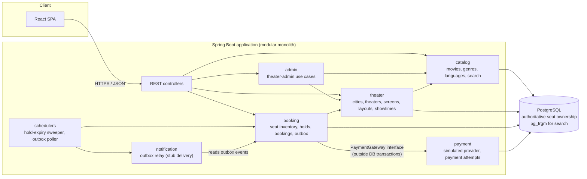
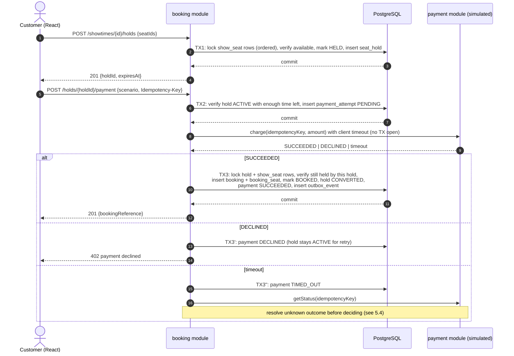

# Architecture

> **Status: PROPOSED DESIGN. No application code exists yet.**
> This document describes the intended design. Section 10 tracks what is actually implemented;
> at the time of writing, **nothing is implemented**. Any statement about behavior below
> ("the system does X") describes the target design, not verified behavior.

## 1. Approach: modular monolith

One Spring Boot application, one PostgreSQL database, one React single-page app, all run
locally via Docker Compose.

Why a modular monolith rather than microservices:

- **Correctness is easiest in one database.** The core invariant (a seat is sold at most once)
  is enforced by a single PostgreSQL transaction plus constraints. Splitting seat inventory,
  booking, and payment into services would require distributed coordination (sagas, two-phase
  patterns) for no benefit at this scope.
- **10-hour budget.** One build, one deployment, one test harness.
- **Boundaries still matter.** Modules are separate packages with public APIs, so a module
  (e.g. search or notifications) could later be extracted if scale demands it.
- **The app tier is stateless**, so it can scale horizontally behind a load balancer;
  the database is the scaling constraint (see §8).

## 2. Component diagram



## 3. Modules

| Module | Responsibility | Key tables (proposed) |
|---|---|---|
| `catalog` | Movies, languages, genres; typo-tolerant search over movies/theaters/showtimes | `movie`, `genre`, `movie_genre`, `language` |
| `theater` | Cities, theaters, screens, seat layouts, showtimes, admin-theater assignments | `city`, `theater`, `screen`, `seat`, `showtime`, `theater_admin` |
| `booking` | Per-showtime seat inventory, holds, bookings, outbox | `show_seat`, `seat_hold`, `booking`, `booking_seat`, `outbox_event` |
| `payment` | Simulated provider with deterministic outcomes; payment-attempt records | `payment_attempt` |
| `admin` | Use cases for theater admins (create/cancel showtime) with authorization checks | — (uses `theater`) |
| `notification` | Relays outbox events to a stub "delivery" (logged / stored) | `notification_log` (optional) |

Search across modules (showtime results need movie + theater + city data) is served by a
read-only query owned by `catalog`. This is the one documented exception to "no cross-module
joins"; it is read-only and does not affect seat state.

## 4. Data model for seat ownership (proposed)

```
showtime (id, screen_id, movie_id, starts_at, ends_at, language, status)
seat     (id, screen_id, row_label, seat_number, category)          -- physical layout

show_seat (showtime_id, seat_id, price, status, hold_id, hold_expires_at, version)
    PK (showtime_id, seat_id)
    status ∈ {AVAILABLE, HELD, BOOKED}

seat_hold (id, showtime_id, customer_id, expires_at, status)
    status ∈ {ACTIVE, CONVERTED, RELEASED, EXPIRED}

booking (id, reference, customer_id, showtime_id, hold_id UNIQUE, payment_attempt_id UNIQUE,
         total_amount, status, created_at)

booking_seat (booking_id, showtime_id, seat_id)
    UNIQUE (showtime_id, seat_id)        -- the "never sold twice" backstop

payment_attempt (id, hold_id, idempotency_key UNIQUE, amount, status, provider_ref, created_at, updated_at)
    status ∈ {PENDING, SUCCEEDED, DECLINED, TIMED_OUT, VOIDED}

outbox_event (id, aggregate_type, aggregate_id, event_type, payload JSONB, created_at, published_at)
```

`show_seat` rows are created for every seat when a showtime is created. This trades storage
for simple, lockable rows: one row per sellable seat per show.

**Defense in depth for "never sold twice":**
1. Row locks (`SELECT … FOR UPDATE`) serialize competing writers on the same `show_seat` rows.
2. Status checks inside the locked transaction reject unavailable seats.
3. `UNIQUE (showtime_id, seat_id)` on `booking_seat` makes a double sale impossible at the
   database level even if application logic is wrong.
4. `UNIQUE (hold_id)` and `UNIQUE (payment_attempt_id)` on `booking` prevent one hold or one
   payment from producing two bookings.

## 5. Booking flow

### 5.1 Overview

The flow is split into **short, separate database transactions**, with the simulated payment
call in between and **never inside** a transaction.



### 5.2 Seat locking (TX1: create hold)

1. Validate request: 1–10 seats, all belonging to the showtime's screen, showtime not started
   or cancelled.
2. `SELECT … FROM show_seat WHERE showtime_id = ? AND seat_id IN (…) ORDER BY seat_id FOR UPDATE`.
   Locking in a **consistent order** (by `seat_id`) prevents deadlocks between overlapping requests.
3. A seat is holdable if `status = AVAILABLE`, or `status = HELD AND hold_expires_at <= :now`
   (lazy expiry — see 5.3).
4. If any seat is not holdable → roll back, return 409 with the conflicting seat ids.
   No partial holds.
5. Otherwise insert `seat_hold` and update the rows to `HELD` with `hold_id` and
   `hold_expires_at = now() + TTL`. Commit.

Pessimistic locking (`FOR UPDATE`) is chosen over optimistic version checks because contention
on popular seats is expected during releases; with optimistic locking most competing requests
would fail late and retry. Lock scope is a handful of rows for milliseconds, so it does not
block unrelated showtimes. `NOWAIT`/`lock_timeout` can bound waiting under heavy contention
(tunable; unresolved in §11).

### 5.3 Temporary holds and expiry

- **Lazy expiry is the correctness mechanism.** Any transaction that locks a seat treats a
  `HELD` row whose `hold_expires_at` has passed as available. Correctness does not depend on a
  background job running on time.
- **A scheduled sweeper** periodically resets expired holds to `AVAILABLE` and marks
  `seat_hold` as `EXPIRED`, so seat maps display accurately. It uses the same row locks and
  `FOR UPDATE SKIP LOCKED` to avoid contending with live requests.
- Customers may release a hold explicitly (abandonment with "Cancel").
- Expiry must be testable deterministically (no sleeps). Proposed: the application passes the
  current time from an injectable `Clock` into expiry queries as a parameter, rather than using
  SQL `now()`. This assumes app-instance clocks are synchronized (NTP); see §11 item 5.

### 5.4 Simulated payment

- The `payment` module exposes a `PaymentGateway` interface: `charge(idempotencyKey, amount)` and
  `getStatus(idempotencyKey)`. The simulated implementation chooses outcomes deterministically
  from a scenario (e.g. test card number or explicit scenario field): `SUCCESS`, `DECLINE`, `TIMEOUT`.
- `TIMEOUT` is simulated by the provider delaying longer than the caller's client timeout.
  The simulated provider records whether the charge was "captured", so `getStatus` has an answer.
- **Idempotency:** the client sends an `Idempotency-Key`; it is stored with a `UNIQUE` constraint
  on `payment_attempt`. Repeating a request returns the original attempt/result rather than
  charging again.
- **Never inside a DB transaction:** the payment attempt is committed as `PENDING` *before*
  calling the provider (TX2), so a crash leaves a durable record that can be reconciled; the
  outcome is applied in a new transaction (TX3).
- **Hold vs. payment timing:** payment may only start if the hold has at least a minimum
  remaining time (proposed: 60 s) greater than the payment client timeout (proposed: 5–10 s).
  This makes "payment succeeded after hold expired" rare, but it is still handled:
  - If TX3 finds the seats no longer held by this hold (expired and taken), the booking fails,
    the payment is marked `VOIDED` (simulated refund), and the customer gets a clear error.
  - If the hold expired but the seats are still free, TX3 may still convert them (they are
    locked and verified within TX3). *Proposed; see §11.*
- **Timeout handling:** a timeout is an *unknown* outcome, not a failure. The attempt is marked
  `TIMED_OUT`, then `getStatus` is queried. If captured → proceed as success (TX3); if not →
  treat as declined. If the status query itself fails, the attempt stays `TIMED_OUT` and the hold
  expires normally; a reconciliation pass would resolve it (MVP: may be a scheduled job or
  documented as a known gap — see §11).

### 5.5 Abandonment

No action is required: the hold expires (lazy + sweeper). A `PENDING` payment attempt older
than a threshold is reconciled via `getStatus` or marked failed.

### 5.6 Downstream notifications (transactional outbox)

- TX3 inserts an `outbox_event` (`BookingConfirmed`) in the **same transaction** as the booking.
  Therefore an event exists if and only if the booking committed.
- A scheduled relay reads unpublished events (`FOR UPDATE SKIP LOCKED`), "delivers" them to a
  stub notifier (log + optional `notification_log` row), and sets `published_at`.
- Delivery is **at-least-once**; consumers must be idempotent on event id.
- This is the integration seam where Kafka could be introduced later (ADR 0002).

## 6. Consistency boundaries

| Boundary | Guarantee | Mechanism |
|---|---|---|
| Seats within a single hold | Atomic (all or none) | One transaction, row locks |
| Seat ownership across customers | Serializable per seat | `FOR UPDATE` on `show_seat`; unique constraint on `booking_seat` |
| Booking + seats + payment status + outbox event | Atomic | One transaction (TX3) |
| Booking ↔ payment provider | Eventually consistent | Idempotency key, persisted attempt, status query, void on conflict |
| Booking → notifications | Eventually consistent, at-least-once | Transactional outbox + poller |
| Search results / seat-map display | May be briefly stale | Read queries without locks; final check happens at hold time |
| Different showtimes | Independent | No shared locks |

The authoritative answer to "who owns this seat?" is always the `show_seat` / `booking_seat`
rows in PostgreSQL. No cache or search index is ever consulted for that decision.

## 7. Search design (proposed)

- PostgreSQL `pg_trgm` extension with GIN trigram indexes on movie title and theater name for
  typo tolerance (similarity / `%` operator), combined with ordinary B-tree-indexed filters
  for city, language, genre, and showtime date.
- Results are paginated with a capped page size.
- Apache Solr is deferred (ADR 0003); the search query sits behind a `catalog` service interface
  so the implementation could be swapped.

## 8. Scale considerations (design notes, not claims)

> The assessment build will **not** be load-tested at the stated scale and makes **no claim**
> to handle 500,000 visitors in 10 minutes. This section explains how the design is shaped by
> that target and what would be needed to approach it.

**Rough numbers (assumptions):**
- 500,000 visitors / 600 s ≈ 830 arrivals/s on average; real release traffic is spikier
  (peaks several times the average), and each visitor makes multiple requests.
- Most traffic is **reads** (search, showtime lists, seat maps). Writes (holds, payments,
  bookings) are bounded by seat supply: a single show has only a few hundred seats.
- Inventory volume: 2,000 theaters × ~5 screens × ~5 shows/day × ~200 seats ≈ **10 million
  `show_seat` rows per day of schedule**. Manageable in PostgreSQL with proper indexes; time-based
  partitioning or archiving of past showtimes would be needed for long retention.

**Design choices that help:**
- Stateless app instances → horizontal scaling of the app tier.
- Short transactions with narrow row locks → contention is limited to the same seats of the
  same show; unrelated shows proceed in parallel.
- Payment outside transactions → database connections are not held during slow I/O.
- Lazy hold expiry → no dependency on background-job timeliness for correctness.
- All-or-nothing holds with fast 409s → losers fail quickly instead of queuing.

**What a production system would add (not in scope):**
- A virtual waiting room / admission control in front of hot releases.
- Rate limiting per user/IP; bot protection.
- CDN and HTTP caching for static assets and read-mostly catalog data.
- Read replicas for search and seat-map reads; connection pooling (e.g. PgBouncer).
- Caching of read-heavy data (Redis — ADR 0001), a dedicated search engine (Solr — ADR 0003),
  and an event backbone (Kafka — ADR 0002), each only when measured need justifies them.
- Load testing (e.g. k6/Gatling) to find the actual limits.

## 9. Security (MVP-level)

- Simplified authentication with seeded users; role-based authorization (`CUSTOMER`,
  `THEATER_ADMIN`) and theater-scoped checks for admins.
- Customers can act only on their own holds and bookings.
- No real payment data is collected; test scenarios only.
- Secrets supplied via environment variables; none committed (see `AGENTS.md`).

## 10. Implementation status

| Component | Status |
|---|---|
| Project scaffolding, Docker Compose | Not implemented |
| Flyway schema | Not implemented |
| Catalog & search | Not implemented |
| Theater & showtimes | Not implemented |
| Seat holds & locking | Not implemented |
| Simulated payment | Not implemented |
| Booking confirmation & outbox | Not implemented |
| Hold-expiry sweeper | Not implemented |
| Admin endpoints | Not implemented |
| React UI | Not implemented |
| Integration / concurrency tests | Not implemented |
| Playwright E2E tests | Not implemented |

This table must be updated as phases are completed and verified.

## 11. Unresolved design decisions

1. **Authentication mechanism** for seeded users (HTTP Basic vs. session/form login vs. a
   simple signed token).
2. **Lock waiting policy** under contention: plain `FOR UPDATE` vs. `NOWAIT` vs. a short
   `lock_timeout`.
3. **Late success after hold expiry, seats still free:** convert anyway (proposed) or always
   void and fail (simpler to reason about).
4. **Timeout reconciliation scope:** scheduled reconciliation job vs. single inline status
   check plus a documented gap.
5. **Clock source:** application `Clock` passed into queries (testable; relies on synchronized
   app clocks) vs. database `now()` (single time source; harder to control in tests).
6. **Module boundary enforcement:** Spring Modulith / ArchUnit test vs. convention and review only.
7. **One active hold per customer per showtime** — enforce with a partial unique index or not.
8. **Seat-map freshness:** polling interval in the UI vs. refresh-on-action only.
