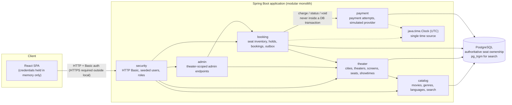
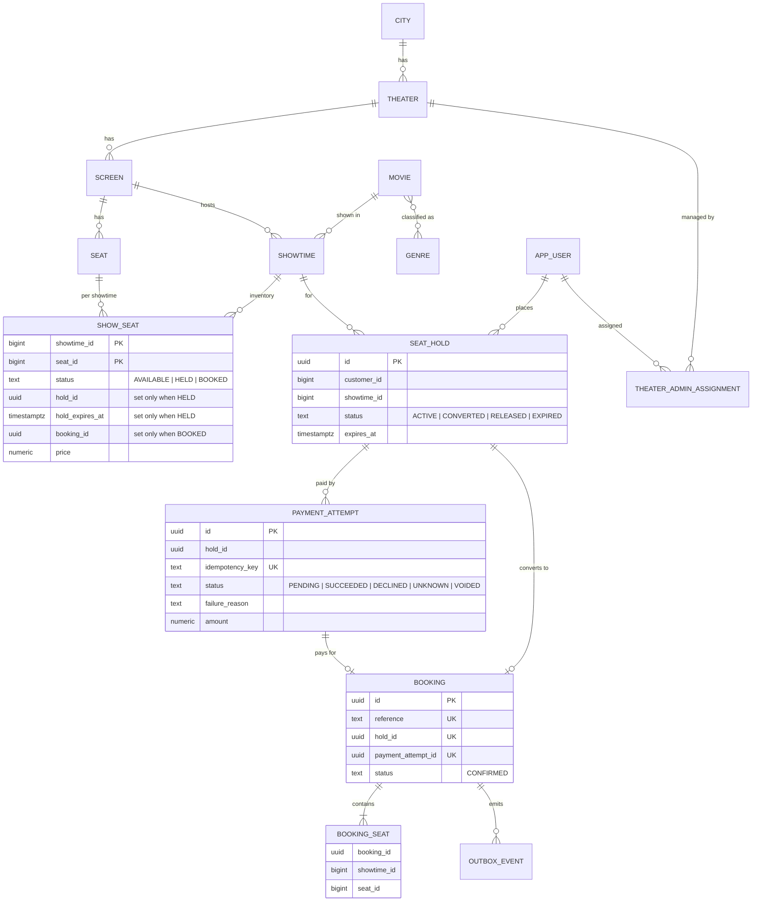
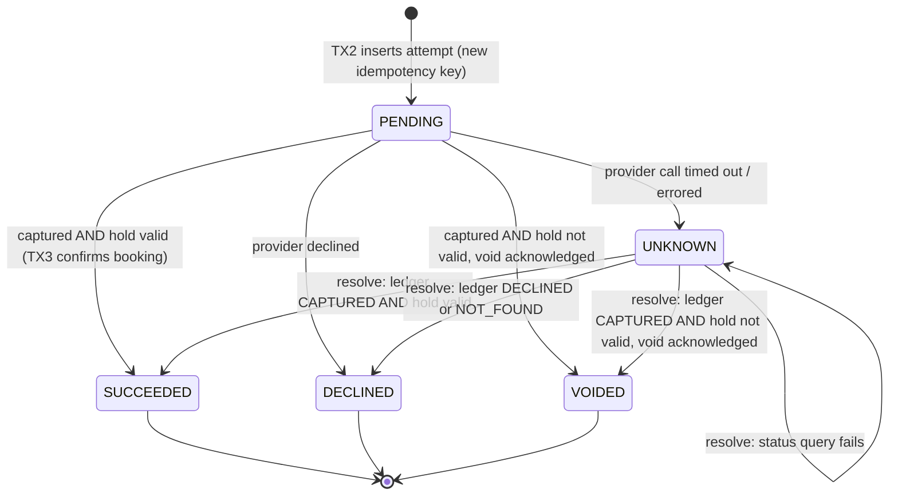
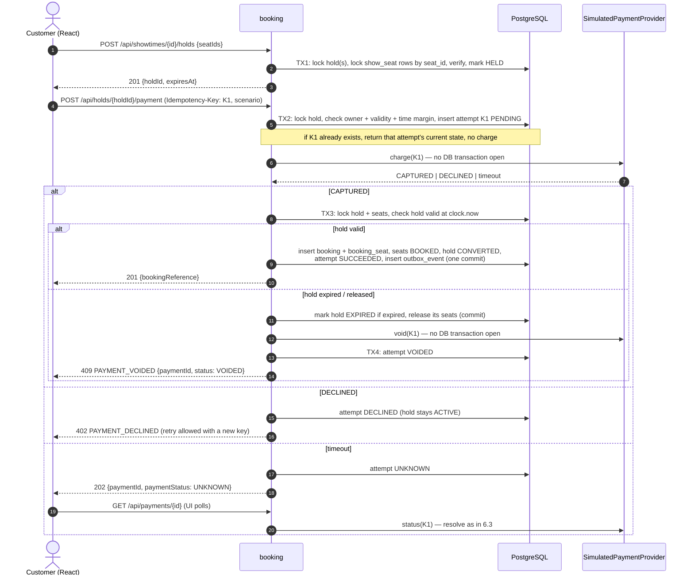

# Architecture

> **Status: DESIGN, IMPLEMENTED EXCEPT WHERE NOTED.** This document was written as the design
> before the code and has been kept in step with it. Section 13 records what is implemented and
> how it was verified. The only implemented background worker is the in-process outbox relay
> (Task 13); the hold-cleanup sweeper and payment reconciliation remain design only. `GET /bookings`
> was added in Task 10; theater-admin reads, screen management and the `/admin` dashboard in
> Task 11; showtime cancellation and `GET /holds/{id}` in Task 12; outbox delivery and the
> notification inbox in Task 13. The implemented schema is in
> `docs/data-model.md`, and the implemented API in `docs/api.md`.
>
> Revision 2 applies design decisions approved by the engineering owner during review of PR #1
> (see `docs/ai-workflow.md` §4). Those were decisions about the *design*, made before any code
> was written.

## 1. Approach: modular monolith

One Spring Boot application, one PostgreSQL database, and one React single-page app, all
running locally via Docker Compose.

Why a modular monolith rather than microservices:

- **Correctness is easiest in one database.** The core invariant (a seat is sold at most once)
  is enforced by PostgreSQL transactions, row locks, and constraints. Splitting inventory,
  booking, and payment into services would need distributed coordination for no benefit at
  this scope.
- **The 10-hour budget.** One build, one deployment, one test harness.
- **Code that can be changed live during review.** Each module is a plain Java package with a
  straightforward `controller → service → repository` structure. There are **no speculative
  interfaces, ports/adapters, or extra layers**: an interface is introduced only when there are
  two real implementations.
- **Stateless app tier.** Requests carry HTTP Basic credentials and there is no server session,
  so the app could be scaled horizontally. The database remains the scaling constraint (§11).

## 2. Component diagram



## 3. Packages and ownership

| Package | Owns | Tables |
|---|---|---|
| `catalog` | Movies, languages, genres; showtime search query | `movie`, `genre`, `movie_genre` |
| `theater` | Cities, theaters, screens, physical seats, showtimes; creating `show_seat` rows when a showtime is created | `city`, `theater`, `screen`, `seat`, `showtime` |
| `booking` | Per-showtime seat inventory, holds, bookings, outbox events, local notification inbox | `show_seat`, `seat_hold`, `booking`, `booking_seat`, `outbox_event`, `notification_inbox` |
| `payment` | Payment attempts, simulated provider and its ledger | `payment_attempt`, `simulated_provider_charge` |
| `admin` | Theater-admin REST endpoints; delegates to `theater` services, and to `booking` for showtime cancellation | — |
| `security` (shared) | Spring Security config, seeded users, theater-admin assignments | `app_user`, `theater_admin_assignment` |

Rules:

- A package writes only its own tables. Other packages call its **concrete service classes**;
  they do not use its repositories directly.
- The discovery reads (movie list, showtime **search**, showtime detail) are read-only SQL in
  `catalog` (`CatalogQueryRepository`). They join theater and city data, and the detail also
  reads seat categories and `show_seat` prices.
- The admin schedule (`TheaterService.getSchedule`) is a read-only query in `theater` that
  aggregates `show_seat` status and prices for one theater's local day. It does not change seat
  ownership.
- Showtime cancellation is orchestrated in `booking` (`ShowtimeCancellationService`): it locks
  the showtime through `theater`, inspects holds, `show_seat` and in-flight `payment_attempt`
  rows, may expire leftover stale holds, and then asks `theater` to set `showtime.status =
  CANCELLED`. Admin calls this service because only booking may change seat ownership. The
  payment package's `countInFlightForShowtime` joins `seat_hold` only to filter attempts by
  showtime; it does not write those rows.
- Those reads, the catalog search, and the admin schedule are the documented exceptions to "a
  package writes only its own tables."
- `theater` inserts the initial `AVAILABLE` `show_seat` rows when an admin creates a showtime
  (one SQL `INSERT … SELECT` in the creating transaction). After that, only `booking` changes them.
- The booking confirmation transaction updates `payment_attempt` by calling the `payment`
  service within the same transaction (Spring `REQUIRED` propagation). This is a deliberate
  cross-package write inside one atomic unit (§6.4).
- Package boundaries are enforced by convention and review. No ArchUnit or Spring Modulith
  test is planned for the MVP.

## 4. Data model

### 4.1 Entity-relationship diagram

This is the design-time view of the booking core. The complete ERD of the implemented schema
(all tables in V1–V13, including `language`, `genre`, `simulated_provider_charge` and
`city.time_zone`) is in **`docs/data-model.md`**, which is authoritative.



### 4.2 Held seats versus booked seats

| | **Held** | **Booked** |
|---|---|---|
| Meaning | Temporarily reserved for one customer's checkout | Permanently sold |
| Where recorded | `show_seat.status = 'HELD'` with `hold_id` and `hold_expires_at` | `show_seat.status = 'BOOKED'` with `booking_id`, **and** a `booking_seat` row |
| Lifetime | Until hold expiry (TTL), release, or conversion | Permanent (no cancellation in MVP) |
| Reversible | Yes: expiry or release makes the seat available again | No: no code path moves `BOOKED` to any other status |
| Protected by | Row locks + status checks | Row locks + status checks + **unique constraint** |

### 4.3 Constraints (explicit)

```
-- The "never sold twice" backstop: at most one booking per seat per showtime, ever.
booking_seat:     UNIQUE (showtime_id, seat_id)

-- One hold or one payment can produce at most one booking.
booking:          UNIQUE (hold_id), UNIQUE (payment_attempt_id), UNIQUE (reference)

-- An idempotency key maps to exactly one attempt (and therefore at most one charge).
payment_attempt:  UNIQUE (idempotency_key)
-- At most one in-flight attempt per hold.
payment_attempt:  UNIQUE (hold_id) WHERE status IN ('PENDING', 'UNKNOWN')

-- The simulated provider charges at most once per key (defense in depth).
simulated_provider_charge: UNIQUE (idempotency_key)

-- One ACTIVE hold per customer per showtime (see §5.5 for why this is valid).
seat_hold:        UNIQUE (customer_id, showtime_id) WHERE status = 'ACTIVE'

-- Row shape matches status.
show_seat CHECK:  (status = 'AVAILABLE' AND hold_id IS NULL AND hold_expires_at IS NULL AND booking_id IS NULL)
               OR (status = 'HELD'      AND hold_id IS NOT NULL AND hold_expires_at IS NOT NULL AND booking_id IS NULL)
               OR (status = 'BOOKED'    AND hold_id IS NULL AND hold_expires_at IS NULL AND booking_id IS NOT NULL)
```

`show_seat` rows are created for every physical seat when a showtime is created. This trades
storage for simple, lockable rows (one per sellable seat per show).

## 5. Seat holds and locking

### 5.1 Lock order (global rule)

Every transaction that locks both holds and seats acquires locks in this order:

1. `showtime` row (`FOR UPDATE`), when the transaction is creating a hold or cancelling the
   showtime. This is the extra first lock that closes the race where a hold would otherwise be
   inserted after cancellation had already decided the show was empty.
2. `seat_hold` row(s) (`FOR UPDATE`)
3. `show_seat` rows for **one showtime**, ordered by `seat_id` ascending (`FOR UPDATE`)

Payment confirmation (TX3) does **not** lock the showtime row: it locks the hold, then the
seats, then reads `showtime.status`. That is safe with cancellation because cancellation takes
the hold locks after the showtime lock, so TX3 either finishes (the show then has BOOKED seats
and cancellation returns 409) or waits. It never confirms a booking for a show whose cancel
transaction has already committed.

Showtime creation (Task 06) and screen-layout replacement (Task 11) lock only the `screen` row
(`FOR UPDATE`, same bounded `lock_timeout`, 409 `SCREEN_BUSY`) before inserting or replacing
rows. They lock no existing hold or `show_seat` rows, so they cannot take part in a cycle with
hold or payment transactions. The screen lock exists because concurrent overlapping inserts
deadlocked on the `showtime_no_overlap_ex` GiST index without it (found by `AdminShowtimeApiIT`),
and because a layout change racing the first showtime would otherwise leave `show_seat` rows
pointing at deleted seats (found by `AdminTheaterApiIT`).

**Cancellation policy (Task 12).** `POST /admin/showtimes/{id}/cancel` is assigned-theater only.
It is refused with 409, and changes nothing, when the show has confirmed bookings
(`SHOWTIME_HAS_BOOKINGS`), in-flight payments (`SHOWTIME_HAS_UNRESOLVED_PAYMENTS`), or
effectively active holds (`SHOWTIME_HAS_ACTIVE_HOLDS`). Expired ACTIVE hold rows are marked
`EXPIRED` and their seats released in the same transaction, then the showtime is set
`CANCELLED`. Inventory and historical rows are never deleted. Repeating cancel on an already
cancelled show is 200 with the same body. Coordinated invalidation of live holds is not
implemented: a customer mid-checkout keeps the hold, and an in-flight simulated capture is
never voided by cancellation. If a charge is running after TX2 has committed `PENDING`,
cancellation is refused until that attempt settles; if it then succeeds, the show has bookings
and can no longer be cancelled. TX3 already refuses to convert a hold when `showtime.status` is
`CANCELLED`. Public search continues to omit cancelled shows; the admin schedule still lists
them. Concurrent holds on one showtime now serialize on the showtime row; that is a throughput
tradeoff in favour of the cancellation race.

All writers follow the same order, so overlapping requests cannot deadlock. If a deadlock is
nevertheless detected by PostgreSQL, the transaction fails and the request returns a retryable
error. It is never silently retried with a partial result.

### 5.2 Bounded lock wait

Each locking transaction sets `SET LOCAL lock_timeout = '2s'` (proposed value, configurable).
If a lock cannot be acquired in time (SQLSTATE `55P03`), the transaction rolls back and the API
returns **409 `SEATS_BUSY`** (retryable). Nothing is partially held. Waits are expected to be
short because transactions contain no network calls and touch at most 10 seat rows.

### 5.3 Creating a hold (TX1)

Input: `showtimeId`, `seatIds`, authenticated customer, `now = clock.instant()`.

**Validation before any locking (400 `INVALID_REQUEST`):**
- `seatIds` is empty or has more than 10 entries.
- `seatIds` contains **duplicates**. These are rejected, not de-duplicated, so the client and
  server agree on exactly what was requested.

**Transaction:**
1. Lock the showtime row (`FOR UPDATE`). It must exist (404) and be `SCHEDULED` with
   `starts_at > now` (409 `SHOWTIME_CLOSED`). The lock serializes with cancellation.
2. Lock this customer's `ACTIVE` hold(s) for the showtime (`seat_hold … FOR UPDATE`):
   - If one exists with `expires_at > now`, return 409 `ACTIVE_HOLD_EXISTS` (including its id).
     The customer must release it or let it expire.
   - If one exists with `expires_at <= now`, mark it `EXPIRED` and add its seats to the set to lock (step 3).
3. Lock the `show_seat` rows for (requested seats ∪ seats of the expired hold from step 2),
   `WHERE showtime_id = :showtimeId AND seat_id IN (…) ORDER BY seat_id FOR UPDATE`.
4. **Missing seats:** if any requested `seat_id` has no `show_seat` row for this showtime
   (unknown id, or a seat from a different screen), roll back and return 400 `INVALID_SEATS`
   listing the ids.
5. Reset any seats of the expired hold from step 2 to `AVAILABLE`.
6. A requested seat is **holdable** if `status = 'AVAILABLE'`, or if `status = 'HELD' AND
   hold_expires_at <= :now` (lazy expiry; the stale hold id on that row is overwritten).
7. If any requested seat is not holdable, roll back and return **409 `SEATS_UNAVAILABLE`**
   listing the conflicting ids. **No partial holds.**
8. Insert `seat_hold(status = ACTIVE, expires_at = now + TTL)` and set the requested rows to
   `HELD` with `hold_id` and `hold_expires_at`. Commit.

**Overlapping multi-seat requests.** Suppose customer A requests seats {1, 2, 3} and customer B
requests {3, 4} at the same time. Both lock in ascending order. Whichever locks seat 3 first
proceeds. The other waits for that lock, bounded by the lock timeout:
- If the winner commits, PostgreSQL (READ COMMITTED) re-reads the row after the wait, the loser
  sees `HELD`, rolls back, and gets 409 `SEATS_UNAVAILABLE: [3]`. None of its seats are held.
- If the winner rolls back, the loser proceeds normally.
- If the wait exceeds the lock timeout, the loser gets 409 `SEATS_BUSY`.

### 5.4 Expiry without background workers

- **Correctness never depends on a background job.** A hold is effectively expired when
  `expires_at <= now`. Every transaction that reads hold or seat state for a decision applies
  that rule (lazy expiry).
- **Seat-map reads** compute the effective status: a `HELD` row with `hold_expires_at <= :now`
  is shown as available.
- `seat_hold.status` may remain `ACTIVE` after expiry until a transaction touches it (§5.3
  step 2, §6.4, or a release). Code must use "effective" state, never the raw status alone.
- An optional cleanup sweeper is on the cut list (`docs/implementation-plan.md`). If built, it
  uses the same lock order and `SKIP LOCKED`.

### 5.5 One active hold per customer per showtime

**Rejected rule:** `UNIQUE (customer_id, showtime_id)` without a predicate. It would block every
future hold by that customer for that showtime, including after expiry or release. A
time-based partial index (`WHERE expires_at > now()`) is not possible either, because
PostgreSQL index predicates must be immutable.

**Adopted rule:** `UNIQUE (customer_id, showtime_id) WHERE status = 'ACTIVE'`. This is valid
because §5.3 step 2 transitions an expired `ACTIVE` hold to `EXPIRED` **in the same
transaction** before inserting the new one. Released and converted holds are already non-`ACTIVE`.
If two concurrent requests from the same customer both find no active hold, the index rejects
the second insert. That request returns 409 `ACTIVE_HOLD_EXISTS`.

### 5.6 Releasing a hold

`DELETE /api/holds/{id}`:
- Only by the hold's owner. Any other caller gets **404**, so hold ids of other customers are
  not revealed.
- Rejected with 409 `PAYMENT_IN_PROGRESS` if the hold has a `PENDING` or `UNKNOWN` payment attempt.
- Otherwise: lock the hold, then its seats (lock order). Set seats to `AVAILABLE` and the hold
  to `RELEASED`. Releasing an already expired or released hold is a no-op returning 204.

## 6. Payment

### 6.1 Simulated provider

- `SimulatedPaymentProvider` is one concrete class in `payment` (no interface; there is one
  implementation). Operations: `charge(key, amount, scenario)`, `status(key)`,
  `statusOrFence(key, amount)` (used by resolution, §6.7), `voidCharge(key)`.
- It represents an external system. It keeps its own ledger in `simulated_provider_charge`
  (`UNIQUE (idempotency_key)`), written in its **own** short transaction. A second `charge`
  with an existing key returns the recorded result without creating a new charge.
- Scenarios are chosen by the client (checkout scenario selector or test card number):

| Scenario | Ledger effect | Response to caller |
|---|---|---|
| `SUCCESS` | `CAPTURED` | success |
| `DECLINE` | `DECLINED` | declined |
| `TIMEOUT` | `CAPTURED` (recorded before the delay) | none within the client timeout: the caller sees a timeout |

`TIMEOUT` deliberately models the hard case: money was taken but the caller does not know it.
- **Guard:** `charge`, `status` (and so `statusOrFence`) and `voidCharge` throw `IllegalStateException` if called while a transaction is
  active (`TransactionSynchronizationManager.isActualTransactionActive()`). This enforces the
  "never inside a DB transaction" rule and is asserted by a test.
- Delays and timeouts are configured durations. Tests drive them with the injected `Clock` and
  latches, not real sleeps, where possible (§7).

### 6.2 Payment attempt states

| State | Meaning | Terminal? |
|---|---|---|
| `PENDING` | Attempt recorded; the charge may not have been sent yet, or may be in flight | No |
| `SUCCEEDED` | Provider captured **and** the booking was confirmed in the same transaction that set this state | Yes |
| `DECLINED` | Provider explicitly declined, or the provider ledger confirms no charge exists (`failure_reason = NOT_RECEIVED`) | Yes |
| `UNKNOWN` | The provider call timed out or errored; the outcome is not known | No |
| `VOIDED` | Provider captured, but the booking could not be confirmed (e.g. hold expired). The capture was voided (simulated refund) | Yes |

### 6.3 State transitions



Rules:
- **Unknown is never treated as declined by default.** `UNKNOWN → DECLINED` happens only when
  the provider's ledger affirmatively reports `DECLINED` or `NOT_FOUND`. While an attempt is
  `UNKNOWN`, no new attempt can be started for that hold, the hold cannot be released by the
  customer, and no booking exists.
- "Hold valid" always means `seat_hold.status = 'ACTIVE' AND expires_at > :now`, with all of the
  hold's `show_seat` rows still `HELD` by this hold. It is evaluated under lock in TX3 using
  `now = clock.instant()`.
- **An expired hold is never converted into a booking**, even if its seats are still available.
  A capture that arrives too late always leads to `VOIDED` and no booking.
- `VOIDED` is written only **after** the provider acknowledges the void. If the app crashes
  between the void and the status update, the attempt stays `PENDING`/`UNKNOWN`. A later
  resolution finds the ledger `VOIDED` and records `VOIDED` (void is idempotent).

### 6.4 Request flow



### 6.5 Starting an attempt (TX2) and idempotency

The client generates a fresh `Idempotency-Key` (UUID) per **user action**, and reuses it for
network retries or double-clicks of that same action.

In TX2 (`now = clock.instant()`), with the hold row locked:
1. **Same key already exists:**
   - If it belongs to the same hold and customer, return the attempt's current state, using the
     same response mapping as a first request. **The provider is not called again.**
   - Otherwise return 422 `IDEMPOTENCY_KEY_REUSED`.
   - Concurrent first requests with the same key: the `UNIQUE (idempotency_key)` insert lets
     exactly one win. The other reads the winner's attempt; if it is still `PENDING` it returns
     409 `PAYMENT_IN_PROGRESS`.
2. The hold must belong to the caller (else 404), be `ACTIVE`, and have
   `expires_at - now >= minimumRemaining` (proposed 60 s, which must exceed the payment client
   timeout plus a clock-skew allowance). Otherwise 409 `HOLD_EXPIRED` / `HOLD_NOT_ACTIVE` /
   `HOLD_TOO_CLOSE_TO_EXPIRY`.
3. No `PENDING` or `UNKNOWN` attempt may exist for the hold. Otherwise 409 `PAYMENT_IN_PROGRESS`,
   with the partial unique index as a backstop.
4. The hold must have fewer than 3 attempts (proposed limit). Otherwise 409 `TOO_MANY_ATTEMPTS`.
5. Insert the attempt as `PENDING` and commit **before** calling the provider.

**Retry after decline:** the UI issues a **new** idempotency key. It is accepted only while the
hold is still valid (rules 2–4). Reusing the declined key returns the stored `DECLINED`
result and does not charge.

### 6.6 Resolution and simulated reconciliation (no background worker)

A single `resolve(attempt)` routine handles both `UNKNOWN` attempts and stale `PENDING`
attempts (older than the payment timeout). It runs **on demand** when:
- the client polls `GET /api/payments/{id}`, or
- the same idempotency key is replayed.

`resolve` calls `statusOrFence(key, amount)` outside any transaction (§6.7) and then applies the
transitions in §6.3.
If the ledger says `CAPTURED`, it runs the same TX3 validity check. If the hold is still valid
it confirms the booking; otherwise it voids.

A scheduled reconciliation job is **not** in the MVP (cut list). Consequence: an `UNKNOWN` or
stale `PENDING` attempt that nobody polls stays unresolved. Its hold expires normally, so the
seats are freed, and a later `resolve` will void the capture.

### 6.7 Crash recovery: limitations (honest statement)

- The attempt is committed as `PENDING` before the charge is sent. After a crash, there is
  always a durable record to resolve.
- If the app crashes after the charge but before TX3, the attempt stays `PENDING`. Resolution
  later reads the ledger: it confirms the booking if the hold is still valid, otherwise voids.
- If the app crashes before the charge was sent, the ledger has no entry, and resolution
  records `DECLINED` with `failure_reason = NOT_RECEIVED`. A `PENDING` attempt becomes eligible
  for resolution after the payment client timeout (5 s). **The timeout alone does not prove the
  charge is no longer running:** a stalled request thread can still call `charge` afterwards.
  Resolution therefore uses `statusOrFence(key, amount)`. If the key is unknown, it inserts a
  `DECLINED` ledger entry for that key, and only then returns `NOT_FOUND`. The ledger's primary
  key decides atomically whether the late charge or the fence came first, and the loser sees the
  winner's status. A charge arriving after the fence replays `DECLINED` and never captures. So a
  `DECLINED` attempt always has a `DECLINED` (never `CAPTURED`) ledger entry for its key.
  - Simulator detail: the ledger CHECK allows only `CAPTURED`/`DECLINED`/`VOIDED`, so a fence is
    stored as `DECLINED` (no migration was added). If the app crashes after fencing but before
    recording the attempt, a later resolution reads `DECLINED` and records `PROVIDER_DECLINED`
    instead of `NOT_RECEIVED`. The outcome is right; only the reason label is wrong.
  - **Remaining limitation (real providers):** the fence relies on the provider letting us burn
    an idempotency key before it has seen it. Real providers generally do not offer this, and
    their status lookups may lag. With a real provider, a not-found result after a timeout is
    **not** definitive. The safe general design keeps the attempt `UNKNOWN` (hold not
    releasable, no new attempt) until the provider settles it. That takes a cancel-by-reference
    call, the idempotency window expiring, a webhook, or a settlement report, with a refund for
    any capture that arrives after the hold is gone. This needs provider-specific integration
    and a scheduled reconciler, both out of scope here.
- **This relies on properties the simulated provider has by construction:** a durable ledger
  queryable by idempotency key, idempotent charge and void, and `NOT_FOUND` meaning the
  charge never happened. Real providers do not guarantee all of these (e.g. eventual visibility
  of charges, asynchronous refunds, voids that fail after settlement). The design does **not**
  claim atomicity between the database and a real payment provider. A production system would
  need provider webhooks, a scheduled reconciliation job, and manual-review workflows for
  attempts that cannot be resolved automatically.

### 6.8 Confirmation transaction (TX3)

With locks taken in the global order (hold, then seats by `seat_id`) and `now = clock.instant()`:

1. Check the hold is valid (§6.3) and the showtime is not cancelled.
2. If valid, do all of the following **in one commit**: insert `booking` (unique `hold_id` and
   `payment_attempt_id`), insert `booking_seat` rows (unique `(showtime_id, seat_id)`), set the
   seats to `BOOKED`, set the hold to `CONVERTED`, set the attempt to `SUCCEEDED`, and insert an
   `outbox_event` (`BookingConfirmed`).
3. If not valid, commit nothing related to the booking. If the hold is expired, it is marked
   `EXPIRED` and its seats released in this transaction. Then the void path runs (§6.4).

Concurrent TX3 for the same hold (e.g. an inline confirm racing a `resolve`) serializes on the
hold lock. The second finds the hold `CONVERTED` and the attempt `SUCCEEDED`, and returns the
existing booking. The `UNIQUE (hold_id)` constraint is the backstop.

## 7. Time

- A single `java.time.Clock` bean is configured as `Clock.systemUTC()`. Every expiry
  calculation and check uses `clock.instant()`: hold creation, TX2 margin checks, TX3 validity,
  seat-map effective status, release, and resolution.
- The current instant is **passed into SQL as a parameter** (`:now`). Business-logic queries do
  not use `NOW()`, `CURRENT_TIMESTAMP`, or column defaults based on them. Audit timestamps
  (`created_at`, `updated_at`) are also set from the `Clock` for consistency.
- Columns are `timestamptz`, mapped to `Instant`. The JDBC/Hibernate time zone is set to UTC.
- **Tests** replace the bean with a mutable test clock (fixed instant, advanced explicitly).
  Expiry tests advance the clock instead of sleeping. The "late capture" test advances the
  clock past hold expiry between `charge` and TX3.
- **Limitation (multi-instance):** with more than one app instance, each instance's clock is
  used. Correctness of seat ownership does **not** depend on clocks: row locks and the unique
  constraint prevent double sales regardless of skew. However, the expiry boundary is only as
  precise as clock synchronization (NTP): a skew of *s* seconds can let one instance accept a
  hold for up to *s* seconds after another considers it expired. The TX2 minimum-remaining
  margin includes a skew allowance. The assessment build runs a single instance.

## 8. Authentication and authorization

- **Spring Security with HTTP Basic**, stateless (no server session, no cookies), for this
  local-only assessment.
- **Seeded demo users** are created by a Flyway migration with BCrypt-hashed passwords: a few
  customers and theater admins. These credentials are **demo-only, non-secret, local-only**. They
  are documented in the README and must never be used in a real deployment.
- **HTTP Basic sends credentials on every request and requires HTTPS in any real deployment.**
  The local Docker Compose stack uses plain HTTP and is not suitable for exposure beyond localhost.
- With stateless Basic auth and no cookies, CSRF protection is disabled. This is acceptable only
  because no cookie-based authentication exists.
- **React demo login:** a login form keeps the credentials in **memory (React state) only**. They
  are not written to `localStorage`, `sessionStorage`, cookies, or IndexedDB, and a page refresh
  requires logging in again. The frontend contains no credentials; demo credentials appear only
  in the README.

### 8.1 Permissions

| Action | Anonymous | Customer | Theater Admin | Implemented |
|---|---|---|---|---|
| Search showtimes, view showtime and seat map | ✔ | ✔ | ✔ | Yes |
| List languages (`GET /languages`) | ✔ | ✔ | ✔ | Yes (Task 11) |
| View own profile (`GET /auth/me`) | — (401) | ✔ | ✔ | Yes |
| Create a hold | — (401) | ✔ | — (403) | Yes |
| Release or pay for a hold | — (401) | Own holds only (others: 404) | — (403) | Yes |
| View a hold (`GET /holds/{id}`) | — (401) | Own holds only (others: 404) | — (403) | Yes (Task 12) |
| View payment status | — (401) | Own attempts only (others: 404) | — (403) | Yes |
| View a booking (`GET /bookings/{id}`) | — (401) | Own bookings only (others: 404) | — (403) | Yes |
| List own bookings (`GET /bookings`) | — (401) | Own bookings only (the customer comes from the credentials) | — (403) | Yes (Task 10) |
| List own notifications (`GET /notifications`) | — (401) | Own inbox only | — (403) | Yes (Task 13) |
| Create a showtime | — (401) | — (403) | Only for theaters they are assigned to (others: 403) | Yes |
| List assigned theaters, screens and a day's showtimes | — (401) | — (403) | Assigned theaters only (others: 403; unknown screen: 404) | Yes (Task 11) |
| Add a screen, or replace its layout before the first showtime | — (401) | — (403) | Assigned theaters only; a layout with any showtime is 409 `SCREEN_HAS_SHOWTIMES` | Yes (Task 11) |
| Cancel a showtime | — (401) | — (403) | Assigned theaters only; 409 if the show has bookings, unresolved payments, or active holds | Yes (Task 12) |

The implemented rows are covered by `SecurityIT`, `ApplicationContextWithoutDatabaseTest`,
`HoldApiIT`, `PaymentApiIT`, `DiscoveryApiIT` and `AdminShowtimeApiIT` (see
`docs/requirements-checklist.md` §5).

Theater scoping is checked in the service layer (`AdminShowtimeService`, `AdminTheaterService`)
against the `theater_admin_assignment` rows loaded with the principal; the theater is derived
from the requested screen, from the showtime's screen, or from the path. URL-pattern rules
alone are not used for this. The anonymous rows above are implemented as `permitAll` for `GET`
on the browsing paths (`/cities`, `/movies`, `/languages`, `/showtimes`, `/showtimes/*`,
`/showtimes/*/seats`).

## 9. Downstream notifications (transactional outbox)

- TX3 inserts an `outbox_event` (`BookingConfirmed`) in the **same transaction** as the booking.
  An event exists if and only if the booking committed.
- A Spring `@Scheduled` dispatcher (disabled in tests) claims unpublished due rows with
  `FOR UPDATE SKIP LOCKED`, in batches of 20. Claim sets `claimed_until` (30 s lease), a new
  `claim_token` UUID, and increments `attempt_count`, then **commits**. The local consumer then
  writes `notification_inbox` with `INSERT … ON CONFLICT (event_id) DO NOTHING`. Only after that
  insert commits does the dispatcher set `published_at`, and only if `claim_token` still matches
  and the row is unpublished. That is at-least-once local delivery, not exactly-once network
  delivery: there is no email, SMS or Kafka.
- The lease is a *visibility* timeout so another worker can reclaim a stuck row. It does not
  cancel in-flight work. A late ack or failure from the expired worker is a no-op because its
  token no longer matches. A crash after the inbox write and before `published_at` is recovered
  by another claim after the lease expires; the second insert is a no-op and the new owner acks.
- Transient consumer failures record `last_error` and `next_attempt_at` with bounded exponential
  backoff (1 s, doubling, cap 60 s), again only when the caller still owns `claim_token`. After
  8 claims the row stays unpublished for inspection and is no longer picked up. The poller does
  not hot-loop: it only claims rows whose `next_attempt_at` is due.
- The dispatcher is never invoked from the checkout or payment transactions.
- Kafka remains deferred (ADR 0002). This in-process poller is the assessment stand-in, not a
  production broker: one process, one consumer, PostgreSQL as the queue, no replay of a topic.

## 10. API

This is the design table, annotated with implementation status. The reference for the
implemented endpoints, with real request and response examples and the complete error codes
(including `HOLD_CONVERTED` for releasing a booked hold), is **`docs/api.md`**. Not implemented:
hold sweeper and scheduled payment reconciliation. The outbox relay is implemented in-process
(§9); Kafka is still deferred.

All paths are under `/api`. Errors use a JSON body `{ "code": "…", "message": "…", "details": … }`.

| Method & path | Auth | Purpose / notable responses |
|---|---|---|
| `GET /cities` | any | Cities with `timeZone` (implemented) |
| `GET /movies` | any | Movies with language, duration, certification, release date, genres (implemented) |
| `GET /languages` | any | Languages a showtime may be shown in, by name (implemented in Task 11) |
| `GET /showtimes?cityId=&date=&q=&language=&genre=&movieId=&page=&size=` | any | Typo-tolerant search (§11); `date` is a local date, default today per city; `size` default 20, capped at 50; `page` 0–1000; 400 `INVALID_REQUEST` with `details.parameter` (implemented) |
| `GET /showtimes/{id}` | any | Movie, theater, city, screen, language, UTC and local times, prices per seat category; 404 (implemented) |
| `GET /showtimes/{id}/seats` | any | Seat map with effective status (§5.4) |
| `POST /showtimes/{id}/holds` | customer | 201 hold; 400 `INVALID_REQUEST` / `INVALID_SEATS`; 409 `SEATS_UNAVAILABLE` / `SEATS_BUSY` / `ACTIVE_HOLD_EXISTS` / `SHOWTIME_CLOSED` |
| `GET /holds/{id}` | owner | Hold detail and expiry (effective status via the Clock; does not extend the hold; others: 404) |
| `DELETE /holds/{id}` | owner | 204; 409 `PAYMENT_IN_PROGRESS` |
| `POST /holds/{id}/payment` (header `Idempotency-Key`, body `{scenario}`) | owner | 201 payment with booking; 202 `UNKNOWN`; 400 `INVALID_REQUEST`; 402 `PAYMENT_DECLINED`; 409 `PAYMENT_VOIDED` (captured, then voided because the hold could no longer be booked) / `PAYMENT_IN_PROGRESS` (also for a replayed key whose attempt is still `PENDING`) / `HOLD_EXPIRED` / `HOLD_NOT_ACTIVE` / `HOLD_TOO_CLOSE_TO_EXPIRY` / `TOO_MANY_ATTEMPTS` / `SEATS_BUSY`; 422 `IDEMPOTENCY_KEY_REUSED` |
| `GET /payments/{id}` | owner | 200 current state (with the booking once `SUCCEEDED`); triggers on-demand resolution if `UNKNOWN` or stale `PENDING` |
| `GET /bookings/{id}` | owner | Confirmation: reference, movie, theater, screen, city, start time, seats, total |
| `GET /bookings?page=&size=` | customer | Own `CONFIRMED` bookings, newest first (`created_at DESC, id DESC`); no customer parameter; `size` default 10, capped at 50; `page` 0–1000; 400 `INVALID_REQUEST` (implemented in Task 10) |
| `GET /notifications?page=&size=` | customer | Own inbox rows from the local outbox consumer, newest first; no customer parameter; same page bounds as bookings (Task 13) |
| `GET /auth/me` | authenticated | Current user id, username, display name and role (used by the React login flow) |
| `POST /admin/showtimes` (body: `movieId`, `screenId`, `languageCode`, `startsAtLocal`, `standardPrice`, `premiumPrice`) | theater admin (scoped by the screen's theater) | 201 with seat inventory; 400 `INVALID_REQUEST` (`details.fields`) / `INVALID_START_TIME` (past, DST gap or overlap); 403 not assigned; 409 `SHOWTIME_OVERLAP` / `SCREEN_BUSY` (implemented; replaces the proposed `/admin/theaters/{theaterId}/showtimes`) |
| `GET /admin/theaters` | theater admin | Assigned theaters with screens and seat counts; the list comes from the principal (Task 11) |
| `GET /admin/theaters/{theaterId}/showtimes?date=` | theater admin (assigned) | That theater's local day, cancelled and started shows included, with prices and booked/held counts; default date is today in the theater's zone; 400 if `date` is outside 2000–2100; 403 if not assigned (Task 11) |
| `POST /admin/theaters/{theaterId}/screens` | theater admin (assigned) | 201 screen with seats; 400 `details.fields`; 409 `SCREEN_NAME_TAKEN` (Task 11) |
| `GET /admin/screens/{screenId}` | theater admin (assigned) | Seating plan; 404 if unknown, 403 if not assigned (Task 11) |
| `PUT /admin/screens/{screenId}/layout` | theater admin (assigned) | Replace seats only while the screen has never had a showtime; 409 `SCREEN_HAS_SHOWTIMES` / `SCREEN_BUSY` (Task 11) |
| `POST /admin/showtimes/{id}/cancel` | theater admin (assigned) | 200 `CANCELLED`; idempotent if already cancelled; 403 other theaters; 409 `SHOWTIME_HAS_BOOKINGS` / `SHOWTIME_HAS_UNRESOLVED_PAYMENTS` / `SHOWTIME_HAS_ACTIVE_HOLDS` (Task 12) |

`docs/api.md` was written in the final audit from the implemented controllers and the running
stack.

## 11. Search (implemented in Task 06)

- `q` matches movie titles and theater names with `pg_trgm` word similarity:
  `q <% m.title OR q <% t.name`, at PostgreSQL's default `word_similarity_threshold` (0.6).
  On the sample data this accepts one-character typos and partial names ("Intersteller",
  "Starlite", "Galeria") and rejects unrelated text. Results with `q` are ranked by the higher
  of the two similarities, then start time; without `q`, by start time, theater name and id.
  In the Task 14 audit, `EXPLAIN` on the sample data (1,306 showtimes) showed the planner
  narrowing by date with `showtime_scheduled_starts_at_idx` and applying the trigram match as a
  filter, so the V6 GIN indexes were not used at that size. Their use at scale has **not** been
  measured (no load test).
- Filters: `cityId`, `movieId`, `language` (code), `genre` (name, case-insensitive), and a
  **local** date. Only `SCHEDULED` showtimes that start after the clock's `now` are listed.
- **Local dates:** each city has an IANA `time_zone` (V9). The date filter is the half-open UTC
  range `[date 00:00, date+1 00:00)` in the theater's zone, computed per row in SQL, so a
  23:30 show stays on its local date and DST is handled by PostgreSQL's zone rules. Without a
  `date`, "today" is computed per city from the injected clock's instant (passed as `:now`).
- Pagination: `count(*)` plus `LIMIT/OFFSET`; `size` is capped at 50 and `page` at 1000 to
  bound `OFFSET`. Count and page are two statements, so under concurrent showtime creation the
  total can be momentarily inconsistent with the page; acceptable for browsing.
- Solr is deferred (ADR 0003).

## 12. Scale considerations (design notes, not claims)

> The assessment build will **not** be load-tested at the stated scale and makes **no claim**
> to handle 500,000 visitors in 10 minutes. This section explains how the target shaped the
> design and what would be needed to approach it.

**Rough numbers (assumptions):**
- 500,000 visitors / 600 s ≈ 830 arrivals/s on average. Real release traffic is spikier, and
  each visitor makes several requests.
- Most traffic is **reads** (search, showtimes, seat maps). Writes (holds, payments, bookings)
  are bounded by seat supply: one show has a few hundred seats.
- Inventory: 2,000 theaters × ~5 screens × ~5 shows/day × ~200 seats ≈ **10 million `show_seat`
  rows per scheduled day**. This is manageable with indexes; long retention would need
  partitioning or archiving by show date.

**Design choices that help:**
- Short transactions with narrow, ordered row locks and a bounded lock wait. Contention is
  limited to the same seats of the same show, and losers fail fast with 409.
- Payment calls happen outside transactions, so connections are not held during slow I/O.
- Lazy expiry: correctness does not depend on background-job timeliness.
- Stateless app tier.

**What a production system would add (out of scope):** a virtual waiting room / admission
control, rate limiting and bot protection, a CDN and HTTP caching, read replicas and connection
pooling (e.g. PgBouncer), HTTPS termination, and load testing (e.g. k6/Gatling). Redis, Solr,
and Kafka would be added only when measurements justify them (ADRs 0001–0003).

## 13. Implementation status

| Component | Status |
|---|---|
| Project scaffolding, Docker Compose | Implemented (Phase 1, PR #2). Task 07 added the `frontend` service (nginx serving the React build and proxying `/api` and `/actuator` same-origin), a backend healthcheck, and stopped publishing the backend port. Verified in Task 07: `docker compose up --build` started all three services healthy in the agent VM, health and API reachable through the proxy. |
| Flyway schema and seed data | Implemented (V1–V13; V9 adds `city.time_zone` in Task 06; V10 replaces the booking customer index with the history index in Task 10; V11 seeds Playwright-only customers `e2e.alice` and `e2e.bob`; V12 adds outbox claim/retry columns and `notification_inbox`; V13 adds `claim_token` fencing). Since Task 06, verified with Testcontainers (PostgreSQL 16.15, `./mvnw clean verify`). |
| Security (HTTP Basic, seeded users, scoping) | Implemented (PR #2). Since Task 06, the browsing `GET` endpoints and the seat map are anonymous as §8.1 requires; holds, payments, bookings and admin endpoints are unchanged. |
| Catalog & search | Implemented (Task 06): `GET /cities`, `/movies`, `/showtimes`, `/showtimes/{id}` (§10, §11). Task 11 added `GET /languages`. Verified by `DiscoveryApiIT` and `AdminTheaterApiIT` on Testcontainers. |
| Theater & showtimes | Implemented (Task 06): admin showtime creation with seat inventory, DST-aware local start times, overlap rejection by the exclusion constraint, per-screen lock (§5.1). Task 11 added assigned-theater overviews, the day's schedule (including started and cancelled shows), adding a screen, and replacing a layout only before the first showtime under the same screen lock. Task 12 added assigned-theater cancellation: refuse when bookings, unresolved payments or live holds exist; idempotent re-cancel; no row deletion. Verified by `AdminShowtimeApiIT`, `AdminTheaterApiIT` and `ShowtimeCancellationIT`. |
| Seat holds & locking | Implemented (Phase 2): create hold, release hold, seat map (§5.3, §5.4, §5.6). Locks use native `SELECT … FOR UPDATE`. First verified on local PostgreSQL 16; since Task 06 verified on Testcontainers (`HoldApiIT`, `HoldConcurrencyIT`). The §5.6 `PAYMENT_IN_PROGRESS` release check was added in Phase 3. Task 12 added `GET /holds/{id}` (owner-only, Clock-based effective status, no TTL extension) and the showtime row lock on hold creation so it cannot race cancellation. |
| Simulated payment & attempt states | Implemented (Phase 3): provider with ledger and transaction guard, attempt states, idempotency, on-demand resolution (§6). First verified on local PostgreSQL 16; since Task 06 verified on Testcontainers (`PaymentApiIT`, `PaymentConcurrencyIT`, `SimulatedProviderFenceIT`). No background reconciliation (by design). |
| Booking confirmation & outbox write | Implemented (Phase 3): TX3 (§6.8), `GET /bookings/{id}`. Task 10 added `GET /bookings`. Task 13 relays unpublished `BookingConfirmed` rows in-process (`FOR UPDATE SKIP LOCKED`, `claim_token` fencing, `INSERT … ON CONFLICT` inbox, `published_at` after the inbox commit). Verified by `PaymentApiIT` and `OutboxDeliveryIT`. |
| Admin endpoint (create showtime) | Implemented (Task 06): `POST /admin/showtimes`, theater-scoped (§8.1). Task 11 added theater/screen/schedule reads, screen creation and pre-showtime layout replacement, and the admin dashboard at `/admin`. Task 12 added `POST /admin/showtimes/{id}/cancel` and a Cancel control on the dashboard. |
| React UI | Implemented (Task 07): customer flow (discover, movie, seats, checkout, ticket). Frontend unit tests (Node test runner) cover the API client, payment-outcome classification and helpers. Booking flows (success after decline, timeout/`UNKNOWN` polling, seat conflict, admin refused, hold expiry) were exercised in headless Chrome against the Compose stack by a throwaway script in Task 07. Since Task 08, the booking, decline-retry and seat-conflict flows are covered by the Playwright suite. Task 10 added the My Tickets screen (`/tickets`, history held in React state only) and fixed a race where a pending search debounce navigated a user who had just opened a showtime back to Discover. Task 11 added the theater-admin dashboard (`/admin`): assigned theaters only, screens with a locked-layout rule, scheduling a showtime, and hiding Hold from admins. Task 12 added a Cancel control on that dashboard and, after a reload, checkout can recover an ACTIVE hold via `GET /holds/{id}` once the customer signs in again. Passwords stay in memory. Task 13 added `/notifications` backed by `GET /api/notifications` (no client-side fake inbox). |
| Integration / concurrency tests | Security, schema, hold, payment, discovery and admin ITs. Earlier phases ran them on local PostgreSQL 16 only. In Task 06 Docker was installed in the agent VM and the **whole suite ran on Testcontainers for the first time**: 132/132 ITs and 59/59 unit tests passed. |
| Playwright E2E tests | Implemented (Task 08): `frontend/e2e/`, Chromium only. Each test schedules its own showtime through the admin API (the admin UI tests create one through the dashboard instead). Task 10 added 3 tests (search race, search filtering, My Tickets). Task 11 added 2 (`admin.spec.ts`: customer refused; admin schedules a showtime that appears in discovery). Task 12 added 1 (admin cancels a showtime; a customer cannot book it) and switched booking, seat-conflict and My Tickets tests to `e2e.alice` / `e2e.bob`. 9 tests passed on a Mac against the running Compose stack, and `--repeat-each=3` passed 27/27. Task 14 added 1 (a showtime scheduled on the date being viewed appears immediately); 10 passed. Timeout/`UNKNOWN`, keyboard and mobile E2E tests are not implemented. |
| Final audit (2026-11-02) | From a clean database: backend 59/59 unit tests and 132/132 integration tests (Testcontainers), frontend 34/34 unit tests and the build, and Playwright 3/3 on two runs. The README steps were also followed in a fresh clone. Details in `docs/test-strategy.md` and `docs/requirements-checklist.md` §10. |
| Task 10 (2026-11-03) | On a Mac (JDK 23, Docker Desktop): backend 64/64 unit and 142/142 integration tests (Testcontainers), frontend 40/40 unit tests and the build, Playwright 6/6 and 18/18 with `--repeat-each=3` against the running Compose stack, which was rebuilt in place (no volume reset). See `docs/test-strategy.md`. |
| Task 11 (2026-11-03) | On a Mac (JDK 23, Docker Desktop): backend 64/64 unit and 158/158 integration tests, frontend 50/50 unit tests, Playwright 8/8 and 24/24 with `--repeat-each=3` against the running Compose stack, rebuilt in place (no volume reset). Booking `9956RB4M` kept. No new Flyway migration. See `docs/test-strategy.md`. |
| Task 12 (2026-11-03) | On a Mac (JDK 23, Docker Desktop): backend 64/64 unit and 174/174 integration tests, frontend 52/52 unit tests and the build, Playwright 9/9 and 27/27 with `--repeat-each=3` against the running Compose stack, rebuilt in place (no volume reset). Booking `9956RB4M` kept. Flyway V11 seeded Playwright-only customers. See `docs/test-strategy.md`. |
| Task 13 (2026-11-03) | On a Mac (JDK 23, Docker Desktop): backend 66/66 unit and 186/186 integration tests after the claim-token / ON CONFLICT review fix, frontend 53/53 unit tests and the build, Playwright 9/9, `./run-tests.sh` exit 0. Booking `9956RB4M` kept. Flyway V13. |
| Task 14 (2026-11-03) | On a Mac (JDK 23, Docker Desktop): `./run-tests.sh` exit 0 with backend 66/66 unit and 186/186 integration tests, frontend 53/53, Playwright 10/10. Two fixes (admin schedule refresh with a Playwright regression; `run-tests.sh` skip guard on Node 23+). Flyway V1–V13 applied to a disposable empty database. Booking `9956RB4M` kept. A documentation and presentation pass added `docs/deferred-scope.md`. See `docs/test-strategy.md`. |
| Required documentation | Complete in the final audit: `README.md`, `docs/requirements-checklist.md`, `docs/data-model.md`, `docs/api.md`, `docs/test-strategy.md`, and updates to this file, the product scope, the ADRs and the AI workflow record. |

Update this table only after a phase's verification checkpoint has actually passed.

## 14. Decisions resolved in revision 2 and remaining open items

**Resolved by the engineering owner (design decisions made before the code; all are now implemented and tested, see §13):**
- Expired holds are never converted; a late capture is voided (§6.3).
- Payment attempt states, idempotency, retry with a new key, and unknown outcomes are defined
  (§6.2–§6.7).
- An injectable UTC `Clock` is used for all expiry logic, passed into SQL; no SQL `NOW()` (§7).
- Auth is HTTP Basic with Spring Security and seeded demo users; credentials are held in memory
  only in React (§8).
- Lock order, bounded lock wait, explicit constraints, and the one-active-hold policy are
  defined (§4.3, §5).
- Concrete packages with no speculative interfaces; boundaries enforced by convention and
  review (§1, §3).

**Still open (the defaults below are implemented; the owner has not formally confirmed them):**
1. Exact values: hold TTL (8 min), lock timeout (2 s), payment client timeout (5 s), minimum
   remaining hold time (60 s), maximum attempts per hold (3). They are configured in
   `backend/src/main/resources/application.yml`, except the attempt limit, which is a constant.
2. Whether `TIMEOUT` should also have a "not captured" variant to exercise
   `UNKNOWN → DECLINED (NOT_FOUND)` through the UI, or only through integration tests.
3. Response code for `SEATS_BUSY`: 409 (proposed) or 503 with `Retry-After`.
4. ~~How the React app reaches the API locally.~~ Settled in Phase 1: same-origin reverse proxy,
   no CORS configuration. The backend honors `X-Forwarded-*` headers
   (`server.forward-headers-strategy: native`).
