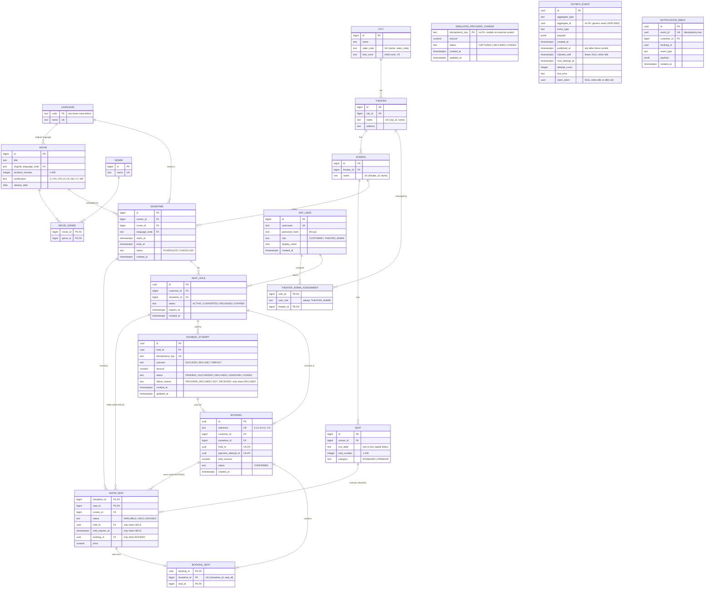

# Data Model

> **Status: IMPLEMENTED.** This document describes the schema created by the committed Flyway
> migrations `V1`–`V13` in `backend/src/main/resources/db/migration/`. It was written from those
> files; if they disagree, the migrations are authoritative. Hibernate runs with
> `ddl-auto: validate`, so the JPA entities must match this schema at startup.

| Migration | Creates |
|---|---|
| `V1__enable_extensions.sql` | `pg_trgm` (typo-tolerant search), `btree_gist` (showtime overlap exclusion) |
| `V2__catalog_schema.sql` | `language`, `genre`, `movie`, `movie_genre` |
| `V3__theater_schema.sql` | `city`, `theater`, `screen`, `seat`, `showtime` |
| `V4__security_schema.sql` | `app_user`, `theater_admin_assignment` |
| `V5__booking_and_payment_schema.sql` | `seat_hold`, `payment_attempt`, `simulated_provider_charge`, `booking`, `show_seat`, `booking_seat`, `outbox_event` |
| `V6__search_indexes.sql` | Trigram GIN indexes on `movie.title` and `theater.name`; partial index on scheduled `showtime.starts_at` |
| `V7__sample_data.sql` | Sample catalog, cities, theaters, screens, seats, showtimes and `show_seat` inventory (`docs/sample-data.md`) |
| `V8__demo_users.sql` | Four public demo users (BCrypt hashes) and two theater-admin assignments |
| `V9__city_time_zone.sql` | `city.time_zone` (IANA zone id) |
| `V10__booking_history_index.sql` | `booking_customer_history_idx (customer_id, created_at DESC, id DESC)` for `GET /api/bookings`; drops `booking_customer_idx`, which was its prefix |
| `V11__e2e_test_users.sql` | Playwright-only customers `e2e.alice` and `e2e.bob` (BCrypt hashes); Alice and Bob are unchanged |
| `V12__outbox_relay_and_notification_inbox.sql` | Outbox claim/retry columns (`claimed_until`, `next_attempt_at`, `attempt_count`, `last_error`); `notification_inbox` keyed by `event_id` |
| `V13__outbox_claim_token.sql` | `outbox_event.claim_token` so ack and failure apply only while that claim still owns the row |

## Entity-relationship diagram

## Constraints that protect the invariants

Each of these exists in the migrations and is exercised by `DatabaseSchemaIT` (run on
Testcontainers PostgreSQL 16).

| Invariant | Constraint |
|---|---|
| A seat is never sold twice | `booking_seat_showtime_seat_uk UNIQUE (showtime_id, seat_id)` |
| One hold and one payment produce at most one booking | `booking_hold_uk`, `booking_payment_attempt_uk` |
| A booking belongs to its hold's customer and showtime | `booking_hold_fk (hold_id, customer_id, showtime_id) → seat_hold` |
| A booking's payment belongs to its hold | `booking_payment_attempt_fk (payment_attempt_id, hold_id) → payment_attempt` |
| An idempotency key maps to one attempt | `payment_attempt_idempotency_key_uk` |
| At most one in-flight attempt per hold | partial unique index `payment_attempt_one_in_flight_per_hold_uk … WHERE status IN ('PENDING','UNKNOWN')` |
| The simulated provider charges at most once per key | `simulated_provider_charge_pk (idempotency_key)` |
| A declined attempt always records why | `payment_attempt_failure_reason_ck` (explicit `IS NOT NULL`) |
| One active hold per customer per showtime | partial unique index `seat_hold_one_active_per_customer_showtime_uk … WHERE status = 'ACTIVE'` |
| A seat row's columns match its status | `show_seat_status_shape_ck` |
| A seat is sold only for its own screen's showtimes | composite FKs `show_seat (showtime_id, screen_id) → showtime` and `(seat_id, screen_id) → seat` |
| A held seat references a hold of the same showtime | `show_seat_hold_fk (hold_id, showtime_id) → seat_hold` |
| Scheduled showtimes on a screen never overlap | `showtime_no_overlap_ex EXCLUDE USING gist (screen_id WITH =, tstzrange(starts_at, ends_at) WITH &&) WHERE status = 'SCHEDULED'` |
| Only theater admins can be assigned to theaters | `theater_admin_assignment_user_fk (user_id, user_role) → app_user (id, role)` with `user_role = 'THEATER_ADMIN'` |

Timestamps have no database defaults. The application sets them from the injected UTC `Clock`
(`docs/architecture.md` §7). The one default in V9 (`city.time_zone`) backfills existing rows
and is dropped in the same migration.

## Screen layouts (no new migration)

Task 11 adds screens and can replace a seating plan **only while that screen has never had a
showtime**, including cancelled or past ones. After the first showtime, `show_seat` and
`booking_seat` reference the physical seats, so changing them would rewrite tickets. The
application takes the same `screen` `FOR UPDATE` lock that showtime creation uses; the
composite FK `show_seat (seat_id, screen_id) → seat` (no `ON DELETE`) is the database backstop.
No Flyway migration was added.

## Booking history reads

`GET /api/bookings` adds no columns and copies no data. A page of bookings is read through
`booking_customer_history_idx`, filtered by `status = 'CONFIRMED'`, and sorted by
`created_at DESC, id DESC`, so ties are broken the same way on every request. The seats, the
showtime, theater, city and time zone, and the movie title are then read from their own
tables in batches, one query each per page. `DatabaseSchemaIT.bookingHistoryIsIndexedByCustomerNewestFirst`
checks the index definition and that the old index is gone. The query plan has not been
measured at scale.

## Tables that exist but are not fully used

- `outbox_event`: a `BookingConfirmed` row is written in the booking transaction. The in-process
  dispatcher claims unpublished due rows (`FOR UPDATE SKIP LOCKED` plus a per-claim `claim_token`),
  the inbox consumer inserts with `ON CONFLICT (event_id) DO NOTHING`, then `published_at` is set
  only if that token still matches. Kafka is not used (ADR 0002).
- `showtime.status = 'CANCELLED'`: set by `POST /api/admin/showtimes/{id}/cancel` when the show
  has no bookings, no unresolved payments and no live holds. Search, holds and confirmation
  already honoured the status. Inventory and historical rows are never deleted.
